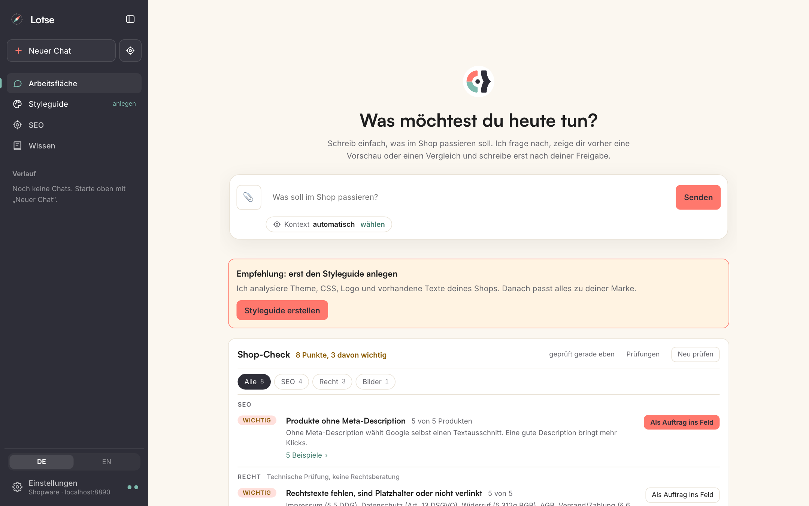
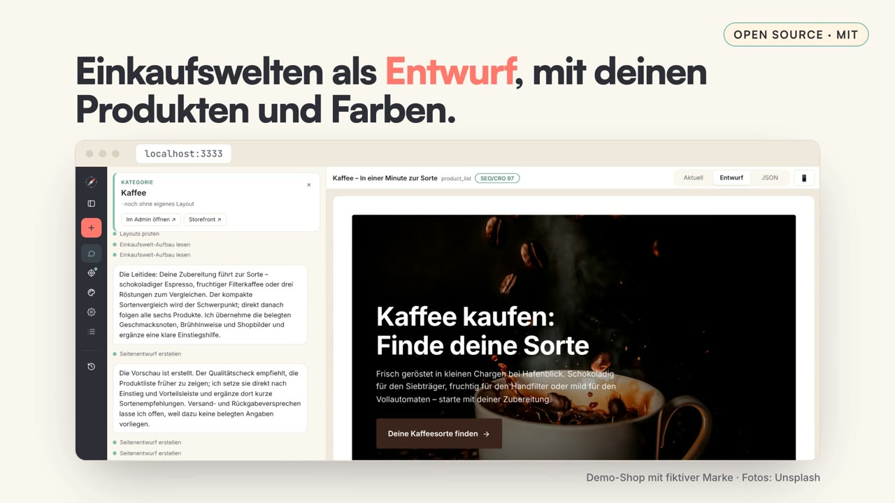
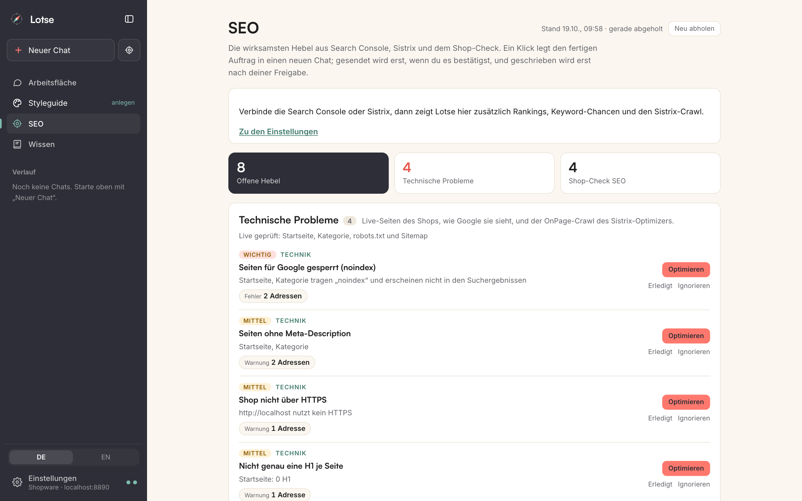
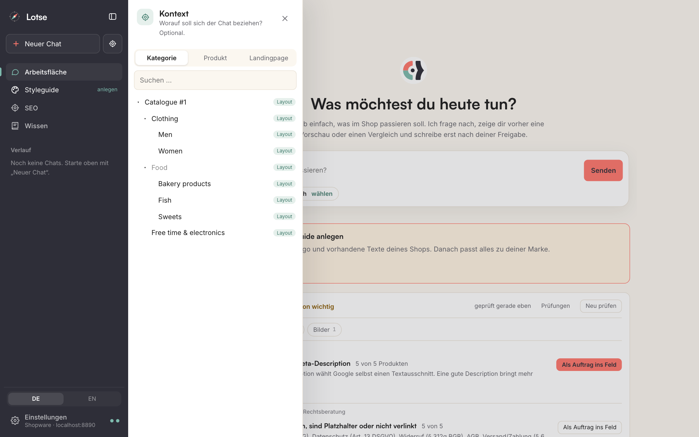
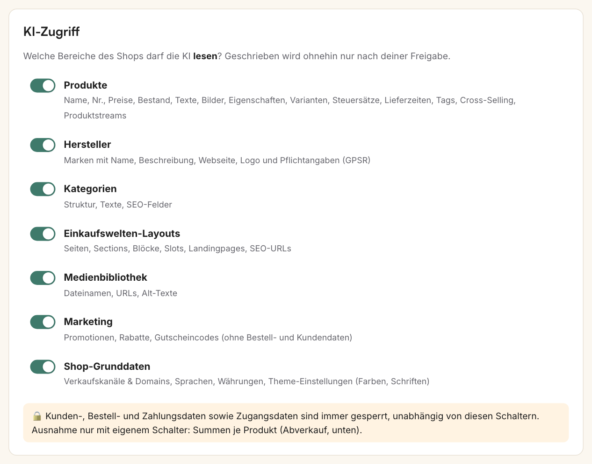

<p align="center"></p>

<p align="center"><b>Deutsch</b> · <a href="README.en.md">English</a></p>

<p align="center"><b>Der KI-Lotse für deinen Onlineshop – Shopware 6, Shopify, Magento 2 und OpenMage.</b> Du gibst den Kurs vor – Lotse bringt deinen Shop sicher hin.<br>
Seiten & Einkaufswelten, Preise, Texte & SEO per Chat. Die KI liest nur, geschrieben wird erst nach deiner Freigabe.</p>

<p align="center"></p>

## Demo

<p align="center"><a href="docs/media/lotse-demo.mp4"></a><br><sub>46 Sekunden: Preise per Chat, Vergleich prüfen, Seite als Entwurf – Klick öffnet das Video</sub></p>

## Screenshots

| Arbeitsfläche mit Shop-Check | SEO-Bereich | Kontext wählen | KI-Zugriff je Bereich |
|---|---|---|---|
|  |  |  |  |

<sub>Screenshots aus einer frischen Lotse-Instanz mit dem Demo-Shop (Dockware), deutsche Oberfläche. Das Video zeigt einen Beispiel-Entwurf mit fiktiver Marke und eigenen Illustrationen.</sub>

## Schnellstart (Docker)

```bash
docker run -d --name lotse --restart unless-stopped \
  -p 127.0.0.1:3333:3333 -e LOTSE_BIND=127.0.0.1 -v lotse-data:/data \
  --read-only --tmpfs /tmp:size=256m,mode=1777 --tmpfs /app/.next/cache:size=64m,uid=1000,gid=1000 \
  --cap-drop ALL --security-opt no-new-privileges:true \
  --pids-limit 512 --memory 2g --cpus 2 \
  ghcr.io/coding9gmbh/lotse:latest
```

> `latest` gibt es erst, wenn der Release-Lauf der Pipeline manuell von einem Tag aus gestartet wurde (siehe [Releases & Image](#releases--image)). Gibt es das Image noch nicht, baust du es mit `make up` aus dem Quellcode.

Dann **http://localhost:3333** öffnen und unter *Einstellungen*:
1. **KI verbinden** – wahlweise
   - **Claude**: Anthropic-API-Schlüssel (console.anthropic.com, Abrechnung nach Verbrauch), oder
   - **ChatGPT-Abo (Codex)**: „Mit ChatGPT anmelden“ → Link öffnen, angezeigten Code eingeben. Funktioniert auch im Container, ohne API-Kosten (es gelten die Limits deines Abos).
2. **Shop verbinden** – im Shopware-Admin unter *Einstellungen → System → Integrationen* eine Integration anlegen und Shop-URL, Zugangs-ID und Schlüssel eintragen.
3. Mit dem **Styleguide-Onboarding** starten, damit Lotse Ton und Farben deines Shops trifft.

Alles (App, KI-Laufzeit, SQLite-Datenbank) steckt im Image; Daten, verschlüsselte Zugangsdaten und Verlauf liegen im Volume `lotse-data` und überstehen Updates.

> Shop auf demselben Rechner? Im Container ist `localhost` der Container selbst – nutze `http://host.docker.internal:<port>`.

## Auf einem Server betreiben

Lotse lässt sich auch selbst hosten, z. B. für ein Team: `LOTSE_PASSWORD` (Login per Umgebungsvariable) und `ALLOWED_HOSTS` setzen, HTTPS per Reverse-Proxy (Caddy, nginx, Traefik) davor. Konfiguration, Proxy-Beispiele, Sicherung und Fehlerbilder: **[docs/self-hosting.md](docs/self-hosting.md)**.

## Aus dem Quellcode / Entwicklung

```bash
make env     # .env aus .env.example (optional – alles geht auch in der Oberfläche)
make up      # Image bauen und starten → http://localhost:3333
make demo    # zusätzlich Demo-Shop (dockware) → http://localhost:8888
make logs    # Logs   ·   make down  stoppen   ·   make backup  Daten sichern
make sandbox-up  # Lotse mit Docker-Zugang für Sandbox Coding (Socket-Proxy, internes Netz)
make help    # alle Befehle
```

Mit dem Demo-Shop in Lotse eintragen: Shop-URL `http://shopware`, öffentliche URL `http://localhost:8888`, Benutzer `admin` / `shopware`.
Ohne Docker: `npm install && npm run dev` (Node ≥ 22.13) → http://localhost:3333. Vor jedem Commit: `npm run check` (Typecheck, ESLint, Tests).

## Sicherheit – damit kein Shop plötzlich down geht

| Schutz | Wie |
|---|---|
| KI ohne Schreibrechte | Das Modell bekommt nur einen geschützten Lese-Client mit Freigabeliste (Shopware `ReadOnlyShopware`, Shopify `ShopifyReader`, Magento `MagentoReader`, OpenMage `OmReader`); Kunden-, Bestell-, Zahlungs- und Zugangsdaten sind fest gesperrt, jeder Lesezugriff wird protokolliert. |
| Freigabe vor jedem Schreiben | Änderungen erscheinen als Alt→Neu-Vergleich; erst „Anwenden“ schreibt. Audit-Log + Rückgängig. |
| Shop wird geschont | Schreibzugriffe gedrosselt (`LOTSE_WRITE_CONCURRENCY`, Standard 2), max. 300 Einträge je Änderungsset, Timeouts (`LOTSE_SHOP_TIMEOUT_MS`), Backoff bei 429/503. |
| Lokal & gehärtet | Port nur auf `127.0.0.1`, Host-/Origin-Prüfung, Container als Nicht-Root, read-only, ohne Capabilities, mit Ressourcen-Limits. |
| Zugangsdaten | AES-256-GCM-verschlüsselt im Volume, gehen nie an die KI. |
| Abverkauf | Standardmäßig aus; einschaltbar unter Einstellungen → KI-Zugriff → Abverkauf. Lotse liest dann mit einer festen Abfrage nur Summen je Produkt (Stückzahl, Umsatz, Anzahl Bestellungen), nie Kunden, Adressen oder einzelne Bestellungen. |
| Internetrecherche | Standardmäßig aus; einschaltbar unter Einstellungen → KI-Zugriff → Internet (Websuche und Abruf öffentlicher Webseiten, nur lesend). |
| Codex (ChatGPT-Abo) | Eigene Codex-Werkzeuge (Shell, Dateien, Web, Bilder, Plugins …) abgeschaltet (Websuche nur bei eingeschalteter Internetrecherche), Dateizugriff per Berechtigungsprofil komplett gesperrt, keine Rückfragen nach mehr Rechten; Shop-Tools nur über einen lokalen MCP-Endpunkt mit Zufalls-Token je Chat. Taucht trotzdem ein gesperrtes Werkzeug auf, bricht Lotse die Runde ab. |
| Sandbox Coding | Standardmäßig aus. Container nur im internen Netz ohne Internet (Internet nur nach Freigabe), die KI hat dort keine Shop-Werkzeuge und führt Befehle nur im Container aus, Befehle aus dem Repository laufen erst nach Freigabe, veröffentlicht wird nur per Klick. Details: [Sandbox Coding](#sandbox-coding). |
| Serverbetrieb | `LOTSE_PASSWORD` (Login) + `ALLOWED_HOSTS` setzen, HTTPS per Reverse-Proxy. Anleitung: [`docs/self-hosting.md`](docs/self-hosting.md). |

Für Live-Shops: eigene Integration mit eingeschränkter Rolle statt Admin-Login, neue Abläufe zuerst im Staging testen. Details: [SECURITY.md](SECURITY.md).

> **Warum kein Claude-Abo?** Anthropic erlaubt Drittprodukten auf Basis des Claude Agent SDK ohne vorherige Freigabe keinen claude.ai-Login und keine Abo-Kontingente ([Agent-SDK-Dokumentation](https://code.claude.com/docs/en/agent-sdk/overview)). Lotse nutzt Claude deshalb nur mit API-Schlüssel – und ignoriert bewusst eine eventuell vorhandene Claude-Code-Anmeldung auf dem Rechner.

## Konfiguration

Alle Variablen mit Erklärung in [`.env.example`](.env.example). In der Oberfläche gesetzte Werte haben Vorrang.
Die Sprache (Deutsch/Englisch) ist keine Variable: Sie wird in den Einstellungen bzw. der Seitennavigation gewählt, Standard ist die Browsersprache (Cookie `lotse_lang`).

| Variable | Zweck |
|---|---|
| `AI_PROVIDER` | `claude` (Standard) oder `codex` (ChatGPT-Abo) |
| `ANTHROPIC_API_KEY` | KI-Zugang Claude (API-Schlüssel) |
| `CODEX_MODEL` | optionales Codex-Modell (leer = Standard des Abos) |
| `SHOPWARE_URL`, `SHOPWARE_CLIENT_ID`, `SHOPWARE_CLIENT_SECRET` | Shop-Zugang (Integration) |
| `SHOPWARE_PUBLIC_URL` | Shop-Adresse aus Sicht des Browsers, falls abweichend |
| `SHOP_PLATFORM` | verbundene Plattform: `shopware` (Standard), `shopify`, `magento` (Magento 2) oder `openmage` (Magento 1 mit dem Modul aus `integrations/openmage/`); Variablen `SHOPIFY_*`, `MAGENTO_*`, `OPENMAGE_*` siehe `src/lib/platforms.ts` |
| `AI_MODEL` | z. B. `sonnet` oder `opus` |
| `LOTSE_AI_BUDGET_USD` | Kostenbremse: Monatsbudget für Claude in US-Dollar (Einstellungen → KI verbinden hat Vorrang); leer = keine Grenze |
| `LOTSE_PASSWORD`, `ALLOWED_HOSTS` | Zugangsschutz für Serverbetrieb ([Selbst hosten](docs/self-hosting.md)) |
| `LOTSE_BIND`, `LOTSE_PORT` | Veröffentlichte Adresse und Port des Containers (Standard `127.0.0.1`, `3333`) |
| `LOTSE_WRITE_CONCURRENCY`, `LOTSE_SHOP_TIMEOUT_MS` | Shop-Schonung |
| `LOTSE_LOG_RETENTION_DAYS`, `LOTSE_AUDIT_RETENTION_DAYS` | Aufbewahrung von Zugriffs- (Standard 180 Tage) und Änderungsprotokoll (365 Tage); `0` = nie löschen |
| `OPENAI_API_KEY`, `IMAGE_MODEL` | optionale Bild-KI |
| `LOTSE_SANDBOX`, `DOCKER_HOST`, `LOTSE_SANDBOX_*` | Sandbox Coding: `0` = hart aus, Docker-Zugang, Grenzen und Netze ([Sandbox Coding aktivieren](docs/self-hosting.md#sandbox-coding-aktivieren)) |

## Releases & Image

Ein Tag `vX.Y.Z` veröffentlicht das Image automatisch (`.github/workflows/docker.yml`); außerdem lässt es sich von Hand starten: GitHub → Actions → *Docker-Image* → *Run workflow*. Push auf `main` und Pull Requests führen nur Typecheck, Lint, Tests, Build und Smoke-Test aus, veröffentlichen aber kein Image.

- Tag `vX.Y.Z` (oder manueller Lauf von diesem Tag): veröffentlicht `ghcr.io/coding9gmbh/lotse` als `X.Y.Z`, `X.Y` und `latest`.
- Manueller Lauf von `main`: veröffentlicht `edge` und ein Tag mit dem Kurz-Hash des Commits.

Gebaut wird für amd64 und arm64, mit SBOM und Provenance. `latest` gibt es erst nach dem ersten Release-Tag; vorher bleibt nur der Bau aus dem Quellcode (siehe unten). Neue GHCR-Pakete sind zunächst privat und müssen einmalig in den Paket-Einstellungen auf *Public* gestellt werden.

## Dokumentation

Die ausführliche Dokumentation liegt unter [`docs/`](docs/README.md): [Benutzerhandbuch](docs/benutzerhandbuch.md) (wie alles funktioniert, auch Sandbox Coding), [Selbst hosten](docs/self-hosting.md), [Architektur](docs/architektur.md) und [Plattform-Schicht](docs/platform.md). Was sich je Version geändert hat, steht im [CHANGELOG](CHANGELOG.md).

## Konzept: AI-first Verwaltung
Chat statt Formulare. Du schreibst, was passieren soll („Ändere das Layout von Produkt XY“, „Senke alle Preise um 20 %“, „FAQ bei allen Produkten“). Der Agent **versteht → fragt gezielt zurück** (klickbare Antworten) **→ recherchiert (nur lesen) → zeigt Vorschau bzw. Alt→Neu-Vergleich → du gibst frei → der Server schreibt** (Audit-Log, Rückgängig).

**Sicherheitsmodell:** Die KI hat ausschließlich Lesezugriff (`ReadOnlyShopware`, kein create/update/upload). Schreiben passiert nur im Executor (`src/server/changes.ts`) nach Klick auf „Anwenden“; jede Anwendung wird im Audit-Log (SQLite, `data/aicb.db`) protokolliert und ist per „Rückgängig“ umkehrbar. Hochgeladene Bild-Anhänge und KI-erzeugte Bilder liegen bis zur Freigabe lokal in `data/staging/` und kommen erst mit einem freigegebenen Änderungsset in den Shop.

## Funktionen
- **Chat-Start mit Beispielen**, Rückfragen mit Antwort-Buttons, Verlauf. Optionaler Kontext (Kategorie/Produkt wählen) mit Direktlinks ins Admin/Storefront.
- **Massenänderungen** (Preise, Streichpreise, Bestand, Aktiv, Texte, SEO) mit serverseitig gerechneten Preisregeln, Warnungen (z. B. −99 %), Zeilen-Auswahl, Audit-Log und Rückgängig.
- **Produktindividuelle Blöcke** (FAQ): gemeinsames PDP-Layout mit Block `pdp-faq`, Inhalt je Produkt im JSON-Zusatzfeld `aicb_blocks` (mit FAQPage-Schema).
- **SEO-Bereich**: Liest Search Console und Sistrix, prüft Seiten technisch (noindex, Canonical, Title, H1, strukturierte Daten) und listet, was sich am ehesten lohnt: Suchanfragen kurz vor Seite 1, Seiten, die sich gegenseitig Rankings wegnehmen, Klickverluste, Seiten mit defekten Bildern, Dateien oder Links. „Optimieren“ legt den fertigen Auftrag in den Chat; die **Wirkungsmessung** zeigt danach je Änderung, was sie gebracht hat.
- **Abverkauf** (standardmäßig aus): Top-Seller und Ladenhüter aus Summen je Produkt, nie aus Kunden oder einzelnen Bestellungen.
- **Kostenbremse**: Monatsbudget für Claude; Hinweis im Chat ab 80 %, ist es erreicht, startet keine neue Runde.
- **Internetrecherche** (standardmäßig aus): Die KI schlägt auf Wunsch öffentliche Seiten nach, etwa Datenblätter von Herstellern, und nennt die Quelle.
- **Styleguide-Onboarding**: Die KI analysiert Theme-Konfiguration, Storefront-CSS, Logo und echte Texte → gespeichert in der Datenbank. Wirkt auf Texte, Farben, Vorschau und die CSS-Variablen (`--sg-*`) in Custom-HTML.
- **Layout mit Bereichswahl** (Shopware): ein Layout für eine Kategorie, einzelne Produkte, alle Produkte einer Kategorie oder den ganzen Shop. Lotse fragt vorher mit echten Zahlen, die Freigabe zeigt, wie viele Seiten ein eigenes Layout verlieren, und Rückgängig stellt jede Seite einzeln wieder her.
- **Entwurf auf der echten Seite**: Kopf, Fuß, Theme, Kaufbox und Produktliste der Zielseite bleiben, nur der Inhalt wird durch den Entwurf ersetzt (Shopware: Einkaufswelt; Shopify, Magento, OpenMage: das HTML, das veröffentlicht wird, im echten Theme). Ohne genanntes Ziel wählt Lotse ein echtes Produkt bzw. eine Kategorie.
- **Eigene Regeln**: feste Vorgaben für Texte („SEO-Texte mindestens 2000 Zeichen“, „wir duzen“), je Bereich (Produkttexte, Seiten, SEO) und optional nur für eine Kategorie. Gepflegt im Styleguide oder per Chat, gelten in jedem Chat.
- **Eigene Shop-Prüfungen** (alle Plattformen): per Chat definierte Prüfungen über feste Felder (Beschreibungslänge, Meta, Preis, Bestand, Bild) erscheinen als Befunde im Shop-Check; vorhandene Prüfungen lassen sich an- und ausschalten.
- **Einkaufswelten-Know-how**: Agent kennt Sections/Blöcke/Slots, liest bestehende Layouts (`get_cms_page`) und bezieht vorhandene Inhalte ein.
- **Custom-HTML/CSS/JS** als `html`-Element (Block `custom-html`, CSS automatisch gescoped).
- **Verlauf**: Alle Chats inkl. Entwurf/Freigaben liegen in der Datenbank und lassen sich im UI wieder öffnen.
- **Sandbox Coding** (optional, braucht Docker): Code-Aufgaben in einer Entwicklungsumgebung mit Git und eigenem Test-Shop, in der Claude Code oder Codex arbeiten – für Plugins, Themes, ganze Shopware-Projekte, ein eigenes Setup oder ohne Projekt; mit Vorschau und Konsole, veröffentlicht als Pull Request oder Plugin-ZIP. Siehe [Sandbox Coding](#sandbox-coding).
- **Deutsch und Englisch**: Oberfläche und KI-Antworten gibt es auf Deutsch und Englisch. Umschalten in den Einstellungen oder in der Seitennavigation; ohne Auswahl gilt die Browsersprache (gespeichert im Cookie `lotse_lang`).
- UI im Coding9-CI (Dunkel `#2E2E38`, Grün, Koralle, Creme; Satoshi/Inter via Fontshare/Google Fonts).

## Sandbox Coding

Für Code statt Shop-Daten: Eine Sandbox ist eine **Entwicklungsumgebung mit Git, in der Claude Code oder Codex arbeiten** – eine Arbeitskopie deines Repositorys und ein eigener Shopware-Test-Shop in Docker (Dockware). Du startest sie aus einem normalen Chat; die KI ändert Dateien, führt Befehle im Container aus, prüft das Ergebnis in der Vorschau und speichert jeden fertigen Schritt als Commit. Den Live-Shop erreicht sie aus einer Sandbox nicht.

| Sandbox starten | Vorschau der Sandbox | Konsole im Container |
|---|---|---|
|  |  |  |

- **Fälle:** bestehendes Plugin oder Theme, neues Plugin (auch in einem neu angelegten GitHub-Projekt), ganzes Shopware-Projekt (Aufbau wie `shopware/production`), eigenes Setup (Zielordner und Befehle legst du fest) oder ganz ohne Projekt mit lokalem Git. Ein Repository kann seine Einrichtung in `.lotse/sandbox.json` beschreiben; Befehle daraus laufen erst nach deiner Freigabe.
- **Daten:** Demo-Daten, eine gespeicherte Datenbank (weitere Sandboxes starten per Snapshot ohne Import) oder ein hochgeladener, bereinigter Dump.
- **Gespeicherte Umgebungen:** einmal einrichten (Projekt, Datenbank, Einstellungen), dann für jeden Auftrag mit einem Klick eine frische Sandbox daraus starten – mehrere nebeneinander, vorher geprüft, ohne geheime Werte; oder der Demo-Shop ohne Projekt.
- **Konsole:** eine eigene Shell im Container (`bin/console`, Logs, Composer) – nur für Menschen, nicht für die KI.
- **Aus dem Container übernehmen:** was in der Konsole oder per Befehl der KI im Container entsteht (z. B. `bin/console plugin:create`, `composer require`), vergleichen und mit denselben Prüfungen wie ein Commit ins Projekt holen.
- **Veröffentlichen:** nur per Klick, als Pull Request auf einen eigenen Branch `lotse/…` oder als Plugin-ZIP zum Hochladen in den Shop. Die KI kann das ZIP per Karte im Chat vorschlagen („gib mir das Plugin als ZIP für den Live-Shop“); geprüft (`composer.json`) und heruntergeladen wird erst mit deinem Klick. Rückmeldungen zum Pull Request gibst du mit einem Klick an die KI weiter.
- **Voraussetzungen:** standardmäßig aus (Einstellungen → Sandbox). Braucht Docker-Zugriff – das ist Root-Zugriff auf den Host – und auf einem Server `LOTSE_PASSWORD`. Mit `make sandbox-up` startet Lotse im Docker-Betrieb mit Socket-Proxy, internem Netz und einem eigenen Seccomp-Profil (`docker/seccomp-codex.json`), das Codex' Dateischreiben erlaubt. Die Container sind offline, Internet gibt es nur nach Freigabe.

Einrichtung: [Sandbox Coding aktivieren](docs/self-hosting.md#sandbox-coding-aktivieren) · Bedienung und alle Fälle: [Benutzerhandbuch](docs/benutzerhandbuch.md#sandbox-coding-sandbox-im-chat) · Sicherheitsmodell: [SECURITY.md](SECURITY.md)

## Unterstützte Shopsysteme

Die Plattform wird in den Einstellungen unter „Shop verbinden“ gewählt (oder per `SHOP_PLATFORM`). Shopware 6 ist der Standard und am weitesten ausgebaut; was genau welche Plattform kann, zeigt die [Fähigkeitsmatrix](docs/platform.md#0-fähigkeitsmatrix-stand-nach-shopify-magento-2-und-openmage) in [`docs/platform.md`](docs/platform.md).

**Alpha:** Aktiv getestet wird bisher nur Shopware 6. Die Anbindungen für Shopify, Magento 2 und OpenMage funktionieren, sind aber noch nicht im Alltag mit echten Shops erprobt; die Einstellungen kennzeichnen sie als „Alpha“. Am besten erst an einem Testshop ausprobieren und Vorschau und Vergleich vor jeder Freigabe besonders sorgfältig prüfen.

| Shopsystem | Einrichtung (Kurzform) |
|---|---|
| **Shopware 6** (Standard) | Im Admin unter *Einstellungen → System → Integrationen* eine Integration anlegen, Shop-URL, Zugangs-ID und Schlüssel eintragen (alternativ Admin-Benutzer; `SHOPWARE_*`). |
| **Shopify** (Alpha) | App im Shopify Dev Dashboard installieren und Client-ID/-Secret eintragen, oder das Admin-API-Token einer bestehenden eigenen App; dazu die `*.myshopify.com`-Domain (`SHOPIFY_*`). |
| **Magento 2** (Adobe Commerce, Alpha) | Im Admin unter *System → Erweiterungen → Integrationen* eine Integration mit Zugriff auf Katalog, Inhalte und Marketing anlegen und das Zugriffstoken eintragen (alternativ Admin-Benutzer); optional Store-View und Preisbasis (`MAGENTO_*`). |
| **OpenMage** (Magento 1, Alpha) | Modul `Lotse_Connector` aus [`integrations/openmage/`](integrations/openmage/) installieren, API-Token erzeugen, Shop-URL und Token eintragen (`OPENMAGE_*`, siehe unten). |

**OpenMage** hat keine brauchbare Schnittstelle für CMS-Seiten/-Blöcke, darum liegt im Repository das Modul **`Lotse_Connector`** ([`integrations/openmage/`](integrations/openmage/)) mit token-gesicherter JSON-API unter `/lotse-api/v1`. Installation in Kurzform (Details, Sicherheit und Endpunkte in [`integrations/openmage/README.md`](integrations/openmage/README.md)):

1. Modul in die OpenMage-Installation legen: Dateien aus `integrations/openmage/` kopieren bzw. das Zip aus `./package.sh` entpacken, per `modman link`, oder per Composer (Typ `magento-module`).
2. Cache leeren, im Admin unter **System → Konfiguration → Lotse → API** die Schnittstelle aktivieren und ein API-Token erzeugen (alternativ `php shell/lotse.php --generate-token`).
3. In Lotse unter „Shop verbinden“ **OpenMage** wählen, Shop-URL und Token eintragen (oder `OPENMAGE_URL`, `OPENMAGE_TOKEN`, optional `OPENMAGE_STORE_CODE`).

Das Modul kennt keine Routen für Kunden, Bestellungen, Zahlungen oder Benutzer – diese Daten erreichen Lotse gar nicht.

## Produktseite

Die Produktseite von Lotse liegt auf [coding9.de/produkte/lotse](https://coding9.de/produkte/lotse) und wird mit der CODING-9-Website gepflegt.

## Aufbau

Next.js 16 (App Router) · React 19 · TypeScript (strict) · SQLite (`node:sqlite`) · Claude Agent SDK oder OpenAI Codex SDK (ChatGPT-Abo).

```
src/
├── proxy.ts              Host-/Origin-Prüfung, optionaler Login, Storefront-Pfade → /shop
├── app/
│   ├── page.tsx          Arbeitsfläche (Chat, Kontext, Vorschau)
│   ├── settings/         Einstellungen: Shop, KI, Bild-KI, KI-Zugriff, Protokolle
│   ├── api/**/route.ts   REST + Chat-Stream (NDJSON)
│   ├── shop/             Storefront-Proxy für die Live-Vorschau
│   ├── sbx/              Proxy für die Vorschau einer Sandbox (Sandbox Coding)
│   └── staged/           vorgemerkte Bilder (vor Freigabe nur lokal)
├── components/           UI nach Bereichen (shell = Navigation, chat, context, preview, dialogs, sandbox, settings, ui), CSS Modules
├── hooks/                useChatStream, useAttachments
├── lib/
│   ├── i18n/             Sprachen (de, en), Wörterbücher je Namensraum unter messages/
│   ├── protocol.ts       Vertrag Server ↔ Oberfläche (REST-Typen, Chat-Ereignisse)
│   └── chat-state.ts     ein Reducer für Live-Stream und Wiederherstellung eines Chats
└── server/               nur serverseitig (`server-only`)
    ├── agent.ts          Chat-Runde: Claude Agent SDK (In-Process-MCP), Streaming des Entwurfs
    ├── agent-codex.ts    Chat-Runde mit Codex (ChatGPT-Abo); Shop-Tools über /api/mcp/<chat> (Token je Chat)
    ├── codex.ts          Codex-Anmeldung (Gerätecode), gesperrte Konfiguration ohne Shell/Dateien/Web
    ├── platform/         Plattform-Schicht: Adapter-Vertrag + Shopware, Shopify, Magento 2, OpenMage, siehe docs/platform.md
    ├── tools.ts          Kern-Tools + Zusammenbau je Plattform (lesen frei, schreiben nur über Änderungssets)
    ├── policy.ts         Schutzschicht: Freigabeliste, gesperrte Daten, Zugriffsprotokoll
    ├── changes.ts        Executor: einziger schreibender Code (gedrosselt, Audit, Rückgängig)
    ├── shopware.ts       Admin-API-Client (Timeouts, Backoff) + ReadOnlyShopware für die KI
    ├── cms.ts / patterns.ts   Block-Katalog, Spec → `cms_page`, HTML-Vorschau
    ├── sandbox/          Sandbox Coding: Docker-Runner, Vorlagen, Einrichtung, Abgleich, Konsole, Veröffentlichen
    └── db.ts / settings.ts    SQLite, verschlüsselte Zugangsdaten
prompts/                  System-Prompt als versioniertes Markdown: common/ (alle Plattformen) + shopware/, shopify/, magento/, openmage/; code/ für Sandbox-Chats
integrations/openmage/    OpenMage-Modul Lotse_Connector (JSON-API, openapi.yaml, Tests, package.sh)
tests/                    alle Tests (node:test), Struktur wie src/
└── support/              Fake-Shops (Shopify, OpenMage) samt Tests und Live-Prüfskripte
```

Neue Blocktypen: in `BLOCKS` (`src/server/cms.ts`) ergänzen (+ Vorschau-Renderer) – der Agent bekommt den Katalog automatisch.
Neue Shop-Plattform: Vertrag, Konventionen und Checkliste in [`docs/platform.md`](docs/platform.md).
Neue UI-Sprache oder Übersetzungen: siehe [CONTRIBUTING.md](CONTRIBUTING.md#übersetzungen).

## Haftungsausschluss

Lotse wird ohne Gewährleistung bereitgestellt, die Nutzung erfolgt auf eigene Verantwortung. KI-Ergebnisse können falsch sein und müssen vor der Freigabe geprüft werden; neue Abläufe zuerst im Staging-Shop testen und vorher ein Backup anlegen. Für die Übermittlung von Shop-Inhalten an den KI-Anbieter bist du als Betreiber verantwortlich. Alle Hinweise: [DISCLAIMER.md](DISCLAIMER.md).

## Lizenz

[MIT](LICENSE) © CODING 9 GmbH
