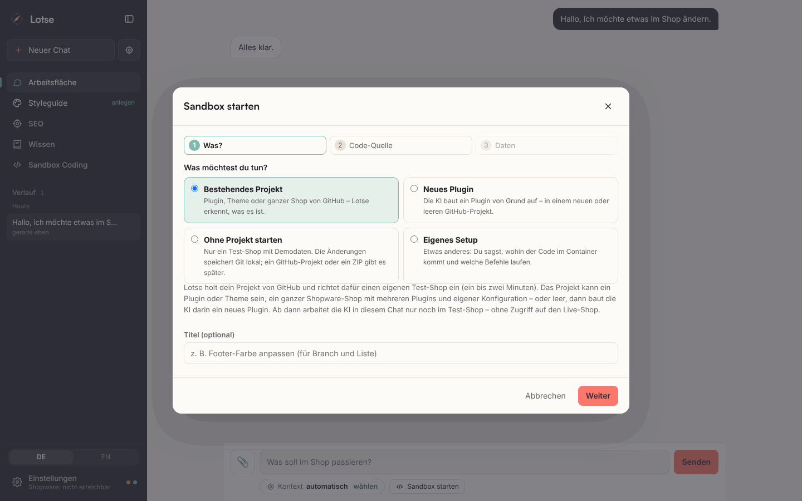
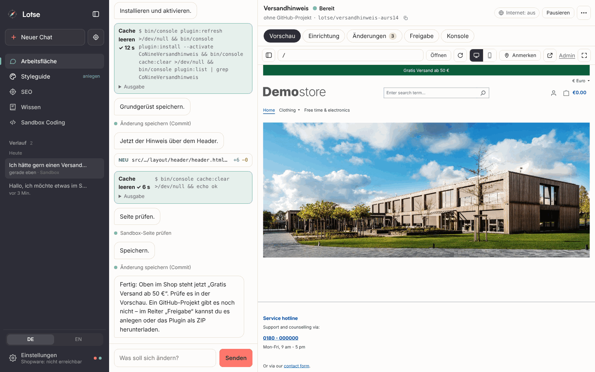
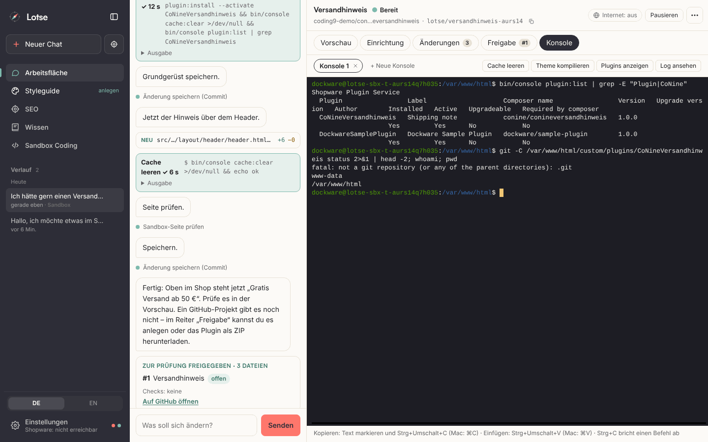

**Deutsch** · [English](en/user-guide.md)

# Benutzerhandbuch

Lotse ist ein KI-Assistent für deinen Onlineshop (Shopware 6, Shopify, Magento 2, OpenMage). Du schreibst, was im Shop passieren soll. Lotse fragt nach, zeigt dir vorher eine Vorschau oder einen Vergleich und schreibt **erst nach deiner Freigabe**.

> Die KI hat nur Lesezugriff. Geschrieben wird ausschließlich vom Server, nach deinem Klick auf „Anwenden“, und jede Änderung lässt sich zurücknehmen.

## 1. Die Oberfläche

| Bereich | Wofür |
|---|---|
| **Arbeitsfläche** | Chat, Kontext und Vorschau. Startseite mit Shop-Check und Beispielen |
| **Styleguide** | Marke (Farben, Schriften, Ton) und eigene Regeln, ein Dialog |
| **Wissen** | Dokumente (Datenblätter, PDFs) als Faktenquelle |
| **Verlauf** | alle Chats; ein Punkt zeigt, ob eine Runde läuft, auf dich wartet oder fertig ist |
| **Einstellungen** | Shop verbinden, KI verbinden, Bild-KI, KI-Zugriff, Protokolle, Sprache |

Neuer Chat: **Neuer Chat** oder **Neuer Chat mit Kontext** (Ziel gleich wählen). Chats bleiben im Verlauf und lassen sich wieder öffnen, samt Entwurf und Freigaben.

## 2. Ein Chat in Kürze

1. **Schreiben, was passieren soll.** Beispiele: „Ändere das Layout der Produktseite von Produkt XY“, „Senke alle Preise in der Kategorie Jacken um 20 %“, „Füge bei allen Produkten eine FAQ hinzu“.
2. **Rückfragen beantworten.** Lotse fragt gezielt nach (klickbare Antworten), wenn etwas offen ist: Umfang, Ton, Reihenfolge. Fehlende Fakten erfindet es nicht.
3. **Vorschau oder Vergleich ansehen.** Seiten erscheinen rechts im Entwurf, Datenänderungen als Alt→Neu-Liste.
4. **Freigeben.** Erst „Anwenden“ schreibt in den Shop.
5. **Bei Bedarf zurücknehmen.** „Rückgängig machen“ stellt den vorherigen Stand her.

Dateien lassen sich anhängen (Bilder, CSV, Excel, PDF, Word, Text; per Klick, Einfügen oder Ziehen). Lotse nutzt sie als Quelle, z. B. Fotos für neue Produkte oder eine Lieferantenliste für einen Import.

### Kontext
Über das Zielsymbol wählst du Kategorie, Produkt oder Landingpage. Dann bezieht sich der Chat darauf, und rechts erscheint die echte Seite. Ohne Auswahl findet Lotse das Ziel aus deiner Nachricht. Ein anderer Kontext in einem Chat mit Verlauf startet automatisch einen neuen Chat, damit die Verläufe sauber getrennt bleiben.

## 3. Vorschau

Die Vorschau rechts hat zwei Ansichten:

- **Aktuell**: die echte Seite im Shop.
- **Entwurf**: der Entwurf von Lotse, im Theme deines Shops.

**Entwurf auf der echten Seite (Shopware).** Kopf, Fuß, Menü, Kaufbox, Beschreibung/Bewertungen, Cross-Selling, Produktliste und Filter sind die echten Teile der Zielseite. Nur der Inhalt dazwischen wird durch deinen Entwurf ersetzt. Nennst du kein Produkt, wählt Lotse ein echtes aktives Produkt mit Bild (bei Kategorie-Layouts dessen Kategorie). 

**Entwurf im echten Theme (Shopify, Magento, OpenMage).** Die Vorschau zeigt die echte Zielseite des Shops (Produkt, Kategorie bzw. Kollektion; bei Landingpages die Startseite als Rahmen) mit Kopf, Fuß und Theme-CSS. Darin steht genau das HTML, das beim Veröffentlichen geschrieben wird: über und unter dem Theme-Inhalt (Produktliste, Produktbereich, Stelle des `theme-main`-Blocks), bei Produkten von Magento und OpenMage in der Produktbeschreibung, bei Landingpages anstelle des Seiteninhalts. Ist die Seite nicht erreichbar (z. B. passwortgeschützter Shop ohne Inhaltsbereich), zeigt Lotse die einfache Vorschau mit den Styleguide-Farben.

**JavaScript in der Vorschau.** Menü, Slider und Galerie des Shops laufen, aber isoliert: die Vorschau hat keinen Zugriff auf Lotse, Cookies oder deine Sitzung, und Skripte von Drittanbietern (Tracking, Consent-Dienste) werden nicht ausgeführt. Funktionen, die Anfragen an den Shop brauchen (z. B. Warenkorb-Fenster), arbeiten in der Vorschau nicht.

**Anmerken.** Mit **Anmerken** klickst du Elemente in der Vorschau an und notierst, was anders sein soll. Die Notizen („Wünsche“) sammeln sich und werden mit **… Wünsche an Lotse senden** gemeinsam als Auftrag abgeschickt. Das geht in „Aktuell“ und „Entwurf“.

**Mobil-Ansicht.** Das Handysymbol schaltet auf eine schmale Darstellung um.

**SEO/CRO-Prüfung.** Zum Entwurf zeigt Lotse eine Bewertung mit konkreten Punkten (Überschriften, Links, Bilder, Struktur). Ein Klick öffnet die Liste.

## 4. Freigabe und Rückgängig

Jede Änderung am Shop läuft über ein **Änderungsset**:

- Du siehst je Zeile **vorher → nachher** mit Warnungen (z. B. Preis −99 %, Preis unter Einkaufspreis).
- Du kannst **Zeilen abwählen**; angewendet wird nur, was ausgewählt ist.
- „Anwenden“ schreibt gedrosselt in den Shop (höchstens 300 Einträge je Set; Stapelregeln darüber hinaus, siehe unten).
- Jede Anwendung steht im Protokoll **Änderungen** (Einstellungen → Protokolle), mit Zeitpunkt, Umfang und Ergebnis.
- **Rückgängig machen** stellt die alten Werte wieder her. Bei Layouts wird jede Seite einzeln zurückgesetzt und das neue Layout wieder entfernt.

**Schreiben ist atomar, wo es Sinn ergibt:** Schlägt bei einer Layout-Veröffentlichung ein Schritt fehl, wird alles zurückgenommen, und im Shop bleibt nichts Halbes.

**Stapel.** Regeln für viele Produkte („alle Preise um 20 % senken und auf .99 runden“) rechnet der Server, nicht die KI. Du siehst Gruppen, Stichprobe und Fehler statt tausender Zeilen.

## 5. Layouts und Seiten

Lotse baut Einkaufswelten-Layouts (Shopware) bzw. Seiteninhalte aus Blöcken: Texte, Bild-Text, Slider, FAQ, eigene HTML-Bereiche u. a. Der Entwurf passt zu deinem **Styleguide** und übernimmt vorhandene Bausteine deines Shops.

### Wo soll ein Layout gelten? (Shopware)
Bevor ein Layout für Kategorien oder Produkte veröffentlicht wird, fragt Lotse mit echten Zahlen nach, **wo** es gelten soll:

| Ziel | Auswahl |
|---|---|
| Kategorie | eine Kategorie · mehrere ausgewählte · alle Kategorien |
| Produkt | ein Produkt · mehrere ausgewählte · alle Produkte einer Kategorie (inkl. Unterkategorien) · alle Produkte im Shop |
| Landingpage | eigene Seite mit URL und Verkaufskanal |

Die Übersicht zeigt, wie viele Seiten dadurch **ein eigenes Layout verlieren** („30 Produkte, davon 4 mit eigenem Layout, wird ersetzt“). Höchstens 1000 Seiten je Veröffentlichung; für mehr zuerst eingrenzen. Meta-Title und -Description gelten nur bei einer einzelnen Kategorie; bei mehreren ergänzt du sie danach per Chat je Kategorie.

## 6. Styleguide und eigene Regeln

Der **Styleguide** beschreibt, wie deine Marke aussieht und klingt: Farben, Schriften, Radius, Ton (Du/Sie, Dos und Don’ts), typische Bausteine. Lotse leitet ihn aus Theme, CSS, Logo und echten Texten ab („Styleguide analysieren“) und wendet ihn auf alles an.

- **Farben** kannst du im Dialog direkt anpassen und speichern.
- **Alles Weitere** änderst du im Chat („Setze die Ansprache auf Du“).
- **Erkannte Bausteine** sind eingeklappt; sie sind Material für die KI.

### Eigene Regeln
Feste Vorgaben für alle Texte, zum Beispiel:

- „SEO-Texte auf Produktseiten haben mindestens 2000 Zeichen.“
- „Wir sagen nie ‚günstig‘, sondern ‚fair kalkuliert‘.“
- „Maße immer in cm.“

Jede Regel hat einen **Bereich** (überall, Produkttexte, Seiten, SEO) und optional eine **Kategorie**, für die sie ausschließlich gilt (dann auch für deren Unterkategorien und Produkte). Regeln legst du im Styleguide-Dialog an oder im Chat („Merk dir: wir duzen unsere Kunden“); Lotse fragt vor dem Speichern nach. Sie gelten in jedem Chat zusätzlich zum Styleguide und gehen bei Widerspruch vor. Höchstens 100 Regeln mit je 300 Zeichen.

## 7. Wissen

Auf der Seite **Wissen** hinterlegst du Dokumente: Datenblätter, PDFs, Word, Excel, CSV, Text (bis 25 MB, keine Kunden- oder Bestelldaten). Lotse speichert sie lokal und nutzt sie als **Faktenquelle** für Produkttexte, FAQ und Sicherheitsinformationen (z. B. GPSR).

- Dokumente lassen sich mit Produkten und Kategorien verknüpfen.
- Jede Angabe aus der Wissensbasis nennt ihre **Quelle** (Dokument und Seite).
- Fehlt ein Fakt, wird er weggelassen oder erfragt, nie erfunden.
- Auszüge gehen als Teil des Prompts an den KI-Anbieter (Anthropic oder OpenAI).

## 8. Shop-Check und eigene Prüfungen

Auf der Startseite zeigt der **Shop-Check**, was im Shop gerade nicht stimmt: SEO, Bilder, Daten, Preise, Links, Sprachen, Recht und Barrierefreiheit (technische Prüfung, keine Rechtsberatung) und Search Console. Jeder Punkt hat Gewicht (Wichtig, Mittel, Hinweis), Anzahl, Beispiele und **Als Auftrag ins Feld**: das legt einen fertigen Auftrag in das Eingabefeld, abgeschickt wird erst mit deinem Klick.

Der Check läuft im Hintergrund (veraltet nach 6 Stunden) oder mit **Neu prüfen**, und nach angewendeten Änderungen automatisch.

### Prüfungen verwalten
Mit **Prüfungen** öffnest du die Liste aller Prüfungen:

- **An/Aus** je Prüfung. Eine ausgeschaltete Prüfung läuft nicht und erscheint nicht.
- **Eigene Prüfungen** (Kennzeichnung „eigene“) lassen sich löschen.
- **Neue Prüfung im Chat anlegen**.

### Eigene Prüfung per Chat
Beispiele:

- „Warne mich, wenn Produktbeschreibungen kürzer als 2000 Zeichen sind.“
- „Melde Produkte mit weniger als 5 Stück Bestand.“
- „Prüfe, ob die Meta-Description fehlt und es kein Bild gibt.“

Lotse formuliert daraus Bedingungen über feste Felder und zeigt dir **vor dem Speichern die Regel in Worten und die Trefferzahl in deinem Shop**. Erst nach „Ja“ wird sie angelegt und erscheint als normaler Befund.

| Feld | Bedeutung |
|---|---|
| Wörter / Zeichen der Beschreibung | Länge ohne HTML |
| Zeichen des Meta-Titles / der Meta-Description | 0 = fehlt |
| Zeichen des Produktnamens | |
| Preis, Streichpreis | brutto |
| Bestand | wo die Plattform ihn liefert |
| Hat ein Bild | ja / nein |

Bedingungen lassen sich mit **und** (alle) oder **oder** (mindestens eine) verknüpfen; Vergleiche: <, ≤, >, ≥, =, ≠. Unbekannte Werte treffen nie zu, es wird nichts geraten. Eigene Prüfungen sehen aktive Produkte, keine Kategorien, Seiten oder Links. Höchstens 20 eigene Prüfungen mit je 5 Bedingungen.

### Wirkung von Änderungen (Search Console)
Ist die Search Console verbunden, merkt sich Lotse beim Anwenden die Suchdaten der 28 Tage davor: für Meta-Title und -Description, Name, Beschreibung, Kurzbeschreibung, FAQ, Titel und Inhalt von CMS-Seiten sowie für neue Layouts bzw. Seiteninhalte bestehender Kategorien und Produkte (höchstens 50 Seiten je Änderungsset, nur Seiten, die Google schon kennt). Im Bereich **SEO → Wirkung deiner Änderungen** siehst du je Änderung den Stand: *Wartet auf Daten* (mit Datum, ab wann gemessen werden kann), *Vorläufig* (ab 14 Tagen) oder *Gemessen* (nach 28 Tagen), mit Klicks pro Tag, Klickrate und Position im Vergleich und einer Einschätzung (*Verbessert*, *Verschlechtert*, *Kein klarer Effekt*, *Zu wenig Daten*). **Jetzt messen** fragt die Search Console für alle offenen Änderungen ab, ohne etwas zu schreiben. Hat eine Änderung geschadet, führt **Zum Chat** zum Änderungsset, wo du sie rückgängig machen kannst; der Shop-Check meldet solche Änderungen zusätzlich. Messungen lassen sich ausblenden.

### Abverkauf: Top-Seller und Ladenhüter
Ist unter Einstellungen → KI-Zugriff der Schalter **Abverkauf** an, liest Lotse aus den Bestellungen eines Zeitraums nur **Summen je Produkt**: Stückzahl, Umsatz (Positionssummen) und Anzahl Bestellungen, ohne stornierte Bestellungen. Kunden, Adressen und einzelne Bestellungen sieht weder Lotse noch die KI. Damit kannst du fragen: „Was sind meine Top-Seller der letzten 30 Tage?“, „Welche Produkte verkaufen sich nicht?“ oder „Welche Top-Seller haben schwache Texte?“. Der Shop-Check meldet im Bereich **Abverkauf** Top-Seller mit dünner Beschreibung, fehlenden Metas oder ohne Bild sowie Ladenhüter (Bestand, aber kein Verkauf in 90 Tagen). Voraussetzung im Shop: Shopware-Integration mit Lesezugriff auf Bestellungen; Shopify-App mit `read_orders` (ohne `read_all_orders` nur 60 Tage); Magento-Integration mit Zugriff auf Vertrieb → Bestellungen; OpenMage mit Modul `Lotse_Connector` ab Version 1.3.0.

## 9. Einstellungen

| Abschnitt | Inhalt |
|---|---|
| **Shop verbinden** | Plattform wählen, Zugangsdaten eintragen, Verbindung testen. Empfohlen: eigene Integration mit eingeschränkter Rolle statt Admin-Login |
| **KI verbinden** | Anbieter (Claude per API-Schlüssel oder Codex per ChatGPT-Abo), Modell, **Monatsbudget** (Kostenbremse für Claude: ist es erreicht, startet keine neue Runde; jede Runde verbraucht höchstens die Hälfte des freien Budgets, auch bei parallelen Chats; ab 80 % Hinweis im Chat; darunter die Kosten dieses Monats und von heute) |
| **Bild-KI** (optional) | OpenAI-Schlüssel und Modell für generierte Bilder; KI-Bilder werden sichtbar gekennzeichnet |
| **KI-Zugriff** | Welche Bereiche Lotse lesen darf (Produkte, Kategorien, Layouts, Medien, Marketing, Shop-Grunddaten). Gesperrte Bereiche werden nicht gelesen, auch nicht vom Shop-Check. Eigene Schalter (standardmäßig aus): **Abverkauf** (nur Summen je Produkt aus Bestellungen, siehe unten) und **Internet** (Websuche) |
| **Protokolle** | **Zugriffe** (jeder Lesezugriff der KI, abgewiesene markiert) und **Änderungen** (freigegeben, abgelehnt, rückgängig, geändert) |
| **Search Console** (optional) | Zugang für Chancen, Inhaltslücken und Erfolgsmessung |
| **GitHub** (optional, unter Integrationen) | Fine-grained Token für Code-Änderungen an Plugins und Themes. Auf GitHub unter *Settings → Developer settings → Fine-grained tokens* nur die nötigen Repositorys auswählen und **Contents** sowie **Pull requests** auf *Lesen & Schreiben* setzen (soll Lotse für neue Plugins selbst Projekte anlegen: zusätzlich **Administration** auf *Lesen & Schreiben* und „All repositories“, siehe [Ohne Entwickler](#ohne-entwickler-so-baust-du-ein-eigenes-plugin)). Der Token wird verschlüsselt gespeichert, automatisch getestet (zeigt den GitHub-Login und Repositorys ohne Schreibrecht) und nie wieder angezeigt, auch nicht der KI. Lotse schreibt nur auf eigene Branches `lotse/…`, nie auf `main` |
| **Sandbox** (optional) | Schaltet **Sandbox Coding** ein (standardmäßig aus): Code-Aufgaben in eigenen Shopware-Containern (Dockware) auf diesem Rechner, dazu Arbeitsspeicher, CPUs und die Pause nach Inaktivität (gestoppt, nicht gelöscht). Braucht Docker-Zugriff, siehe [Selbst hosten](self-hosting.md#sandbox-coding-aktivieren). Image, Umgebungsvariablen, eigene Einrichtungsbefehle und **Hinweise für die KI** legst du im Reiter **Sandbox Coding** fest; geheime Werte werden verschlüsselt und nie angezeigt; Code im Container (auch von der KI geschriebener) kann sie lesen, daher nur Zugangsdaten eintragen, die allein für die Sandbox gelten |
| **Sprache** | Deutsch oder Englisch für Oberfläche und KI-Antworten (siehe unten) |

Kunden-, Bestell-, Zahlungs- und Zugangsdaten sind fest gesperrt und nicht freischaltbar.

### Sandbox Coding: Sandbox im Chat

Eine Sandbox ist eine **Entwicklungsumgebung mit Git-Anbindung, in der Claude Code oder Codex arbeiten**: eine Arbeitskopie deines Repositorys (ohne Projekt: ein lokales Git) und ein eigener Test-Shop (Shopware in Docker), in dem die KI ändert, prüft und ihre Schritte als Commits speichert – veröffentlicht wird erst mit deinem Klick, als Pull Request oder als Plugin-ZIP zum Hochladen in deinen Shop. Das geht mit einem Plugin oder Theme, einem neuen Plugin, einem ganzen Shopware-Projekt, einem eigenen Setup oder ganz ohne Projekt. Du hängst sie an einen ganz normalen Chat der Arbeitsfläche: **Sandbox starten** (mit `</>`-Symbol neben dem Kontext unter dem Eingabefeld) öffnet die Auswahl – deine [gespeicherten Umgebungen](#gespeicherte-umgebungen-einmal-einrichten-für-jeden-auftrag-eine-frische-sandbox), **Demo-Shop ohne Projekt** und **Neu einrichten …**, den Dialog „Sandbox starten“ in drei kurzen Schritten – **Was?**, **Code-Quelle**, **Daten** (siehe [Sandbox starten: jeder Fall](#sandbox-starten-jeder-fall)). Ist Docker nicht erreichbar, ist der Knopf gesperrt und der Dialog sagt das mit einem Link zur Anleitung. Die KI kann eine Sandbox auch selbst vorschlagen („Vorschlag: Sandbox starten“ mit ihrem Grund und derselben Auswahl, eine passende gespeicherte Umgebung oder ihr Projekt vorausgewählt) – angelegt wird sie erst, wenn du **Sandbox starten** klickst; ihr Grund wird zum Titel der Sandbox (**Neu einrichten …** öffnet denselben Dialog). Danach schrumpft die Karte auf eine Zeile. Je Chat gibt es höchstens eine Sandbox. Lotse richtet im Hintergrund einen eigenen Shopware-Container ein; neben dem Chat erscheint statt der Entwurfsvorschau die Sandbox. Ihr Kopf hat zwei Zeilen: Titel und Status, darunter Repository und Arbeits-Branch (mit Kopier-Knopf; der volle Name steht im Tooltip). Rechts daneben stehen der Internet-Status, die eine passende Aktion (**Stoppen**, **Pausieren** oder **Fortsetzen**) und das Menü **⋯** mit **Datenbank ersetzen**, **Alle Sandboxes** und **Sandbox abschließen**; während eine Aktion läuft, zeigt der Status „Pausiere …“ bzw. „Wird gestartet …“ (und keinen Knopf, der dem widerspricht; „Fortsetzen“ erscheint erst, wenn der Container wirklich gestoppt ist). Darunter liegen die Reiter **Vorschau**, **Einrichtung**, **Änderungen**, **Freigabe** (der Pull Request) und **Konsole** (Zahlen sind neutral; ein roter Punkt heißt: hier ist etwas zu tun, z. B. ein fehlgeschlagener Schritt oder eine neue Rückmeldung). Während der Einrichtung ist **Einrichtung** offen: oben „Schritt 5 von 12 · ca. 2 Min.“ mit Fortschrittsbalken, darunter jeder Schritt mit Status und Dauer; das Protokoll klappt beim laufenden und beim fehlgeschlagenen Schritt von selbst auf, bei den anderen per Klick. Schlägt ein Schritt fehl, steht darunter eine Zeile mit der Ursache (die volle Ausgabe im Protokoll), **Ab hier erneut versuchen** setzt dort wieder an, bei eigenen Befehlen führt **Befehl in der Sandbox-Umgebung bearbeiten →** direkt zur Sandbox-Umgebung, und auch der Chat meldet den Fehler. Sobald die Sandbox bereit ist, wechselt die Ansicht zur **Vorschau**, und die Einrichtung schrumpft auf „Eingerichtet in 2:45 min ✓“ (**Details anzeigen** klappt sie wieder auf). Du kannst schon während der Einrichtung schreiben: Die KI startet, sobald die Sandbox bereit ist. **Pausieren**/**Fortsetzen** stoppt und startet den Container (Code, Datenbank und Änderungen bleiben; nach längerer Inaktivität pausiert Lotse von selbst). **Sandbox abschließen** (im Menü **⋯**) löscht Container und Dateien – sind noch Rückmeldungen zum Pull Request offen, warnt die Rückfrage davor; die Sandbox ist dann vom Chat gelöst, der Chat bleibt und ist wieder ein normaler Chat (im Verlauf mit „Sandbox (abgeschlossen)“ markiert), die Sandbox bleibt als Eintrag im Reiter **Sandbox Coding**. Der Reiter ist eine Übersicht: oben die Bereitschaft (eine Zeile, wenn alles eingerichtet ist; sonst ein Hinweis, was fehlt), dann alle Sandboxes mit Status, Repository und PR-Link samt Zustand („PR #1 · offen“, „gemergt“, „geschlossen“; ein Klick öffnet ihren Chat, **Neue Sandbox** startet eine neue in einem neuen Chat – mit derselben Auswahl), darunter die **Gespeicherten Umgebungen**, die gespeicherten Datenbanken und die aufklappbare **Sandbox-Umgebung**. Arbeitsspeicher, CPUs und Pause nach Inaktivität stehen unter Einstellungen → Sandbox; beide Seiten verlinken einander.

| Sandbox starten | Vorschau der Sandbox | Konsole im Container |
|---|---|---|
|  |  |  |

**Mit eigener Datenbank:** Im Schritt **Daten** des Dialogs wählst du **Demo-Daten** (Vorgabe: Shopwares Beispielshop aus dem Dockware-Image), eine **Gespeicherte Datenbank** oder **Dump hochladen**: einen **Datenbank-Dump** (`.sql` oder `.sql.gz` aus `mysqldump`/`mariadb-dump`, ohne `--databases`/`--all-databases`) per Ziehen & Ablegen oder Dateiauswahl – nur bereinigte Dumps ohne Kunden- und Bestelldaten. Der Upload läuft in Teilstücken mit Fortschritt; **Abbrechen** hält ihn an, **Fortsetzen** macht an derselben Stelle weiter. **Für weitere Sandboxes speichern** ist vorausgewählt: Der Dump kommt dann zu den gespeicherten Datenbanken und bleibt, bis du ihn dort löschst. Ohne Haken ist er ein einmaliger Dump und wird **direkt nach dem Import gelöscht** (auch wenn er fehlschlägt); die Zeitleiste zeigt „Dump gelöscht ✓“. Die Einrichtung prüft zuerst, ob der Dump zur Shopware-Version des Images passt: Weicht die Hauptversion ab (z. B. Dump von 6.6, Image 6.7), stoppt sie mit einem Hinweis – besser in der Sandbox-Umgebung ein passendes Image wählen, oder mit **Trotzdem fortfahren** importieren. Danach importiert Lotse den Dump, setzt die Domain auf die Sandbox, installiert dein Plugin, führt die eigenen Befehle „nach der Datenbank“ aus und kompiliert das Theme. **Datenbank ersetzen** im Menü **⋯** spielt später eine andere gespeicherte Datenbank oder einen neuen Dump ein; dein Code bleibt dabei unverändert.

**Gespeicherte Datenbanken:** Im Reiter **Sandbox Coding** listet Lotse sie mit Name, erkannter Shopware-Version, Größe, wann und von wem hochgeladen und wann zuletzt verwendet. **Datenbank hochladen** speichert eine neue, **Löschen** (mit Rückfrage) entfernt Datei und Snapshots; Sandboxes, die sie schon importiert haben, behalten ihre Datenbank. Unter **Umgebung → Vorgaben** wählst du eine als **Datenbank** für „Sandbox starten“ vor. **Schneller Start per Snapshot:** Die erste Sandbox mit einer gespeicherten Datenbank importiert sie und sichert danach eine Kopie der fertigen Datenbank (Schritt „Datenbank-Snapshot sichern“, in der Liste dann „Snapshot bereit“). Jede weitere Sandbox mit derselben Datenbank und demselben Image übernimmt diese Kopie vor dem Start, ohne Import; die Zeitleiste zeigt „aus dem Snapshot übernommen“. Jede Sandbox arbeitet auf ihrer eigenen Kopie – was die KI in einer ändert, sehen die anderen nicht. Nach einem Wechsel des Images importiert die nächste Sandbox wieder und sichert eine neue Kopie.

Die **Vorschau** zeigt die Storefront der Sandbox – zum Ausprobieren wie ein echter Shop: Navigation, Suche, Warenkorb, Kasse und Kundenkonto funktionieren (die Sitzung hält Lotse pro Sandbox auf dem Server). Sie füllt den Reiter randlos aus. Oben trägst du einen Pfad ein (z. B. `/checkout/cart`), lädst neu, wechselst zwischen Desktop und Mobil oder öffnest die Vorschau **in einem neuen Tab**. Ist der Platz schmaler als Shopwares Desktop-Breite (992 px), zeigt „Desktop“ eine verkleinerte 1280-px-Ansicht, damit die Storefront wirklich ihr Desktop-Layout zeigt; unter etwa 700 px startet die Vorschau in der Mobil-Breite (die Desktop-Ansicht wäre dort kaum lesbar) – „Desktop“ schaltet trotzdem um. Mehr Platz: die Trennlinie zwischen Chat und Vorschau mit der Maus (oder den Pfeiltasten) verschieben – Lotse merkt sich die Breite in diesem Browser –, **Chat einklappen** oder **Vollbild** (Esc beendet es). **Admin** öffnet die Shopware-Administration der Sandbox (ohne Gewähr). Die Debug-Leiste von Symfony und der Cookie-Hinweis von Shopware sind in der Sandbox ausgeschaltet (Schritt **Vorschau aufräumen**), damit sie die Vorschau (und Screenshots) nicht verdecken. Nach dem Kompilieren des Themes lädt die Vorschau von selbst neu. Ist die Sandbox pausiert, startet **Fortsetzen** (oder **Vorschau laden**) sie wieder; bis die Storefront die erste Seite ausliefert (Shopware übersetzt nach dem Start seine Vorlagen neu, das übernimmt Lotse noch vor „Bereit“), steht dort „Umgebung startet …“ – in normaler Größe, nicht verkleinert. Die Vorschau zählt als Aktivität. Schlägt der Start einer pausierten Sandbox fehl, versucht es die Vorschau nicht von selbst immer wieder (auch nicht in einem eigenen Browser-Tab): Sie zeigt den Fehler mit **Erneut starten**, erst dieser Klick startet den Container noch einmal.

**Konsole:** Im Reiter **Konsole** öffnest du mit **Konsole öffnen** eine eigene Shell im Container der Sandbox – wie ein Terminal auf dem Test-Shop, für Entwickler und Neugierige: `bin/console`, Logs unter `var/log`, Composer, `mysql`. Sie läuft als Benutzer `dockware` im Shop-Verzeichnis `/var/www/html` (bei einem eigenen Setup liegt der Code im Zielordner, z. B. `cd /opt/app`), Dateien gehören wie gewohnt `www-data`, und `sudo` geht wie in Dockware üblich. Die Knöpfe **Cache leeren**, **Theme kompilieren**, **Plugins anzeigen** und **Log ansehen** tippen den passenden Befehl in die Konsole. Bis zu drei Konsolen gleichzeitig (**+ Neue Konsole**); die Größe passt sich dem Bereich an, Kopieren und Einfügen gehen mit Strg+Umschalt+C/V (Mac: ⌘C/⌘V). Lädst du die Seite neu, verbindet sich eine offene Konsole wieder und zeigt die letzte Ausgabe. Ist die Sandbox pausiert, startet **Konsole öffnen** sie wieder; Eingaben zählen als Aktivität. Ohne Eingabe schließt Lotse eine Konsole nach 30 Minuten, außerdem beim Pausieren, Abschließen, einer neuen Einrichtung und beim Ausschalten von Sandbox Coding – die Konsole sagt dann, warum. Beim Schließen endet alles, was du in der Konsole gestartet hast, auch Befehle mit `sudo` und Hintergrundjobs; nur Dienste, die du neu startest (z. B. `sudo service mysql restart`), laufen weiter. Die KI hat auf die Konsole keinen Zugriff; sie kann dir aber Befehle nennen, die du dort selbst ausführst. Im Audit-Log steht, wer wann eine Konsole geöffnet und geschlossen hat, nicht was getippt wurde.

**Mit der KI am Code arbeiten:** In einem Chat mit Sandbox arbeitet die KI wie ein Entwickler – und **nur** in der Sandbox: Der Live-Shop ist von dort nicht erreichbar (keine Shop-Werkzeuge, keine Änderungssets). Sie liest und ändert die Dateien des Repositorys mit ihren eigenen Datei-Werkzeugen, führt Befehle im Container aus (z. B. `bin/console theme:compile`, Logs, die Datenbank der Sandbox; bei einem eigenen Setup im Zielordner) und prüft die Seite selbst. Jede geänderte Datei erscheint als Karte mit „+/−“-Zeilen, jeder Befehl mit Ergebnis (z. B. „Theme kompilieren ✓ 7 s“ oder die Fehlermeldung); nach dem Kompilieren lädt die Vorschau neu. Wie in Claude Code speichert die KI jeden abgeschlossenen, geprüften Schritt als **Commit** mit eigener Nachricht (Werkzeug „Änderung speichern“) – nur lokal in der Sandbox: kein Push, kein Branch-Wechsel, kein Umschreiben früherer Commits; Autor ist „Lotse“, du stehst als Co-Autor darin. Geschützte Dateien, GitHub-Workflows und alles, was wie ein Geheimnis aussieht, committet sie nicht (die Prüfung ist dieselbe wie beim Veröffentlichen, nur ohne „Trotzdem“). Der Reiter **Änderungen** zeigt oben die **gespeicherten Schritte** (Commits, neueste zuerst, je „lokal“ oder „veröffentlicht“) und – falls vorhanden – was **noch nicht gespeichert** ist, darunter alle Änderungen gegenüber dem Basis-Branch: je Datei ein aufklappbarer Abschnitt mit „neu“/„gelöscht“, +/−-Zahlen und Zeilennummern; ein Klick auf eine Datei in der Liste springt dorthin, nach jeder Dateiänderung aktualisiert er sich von selbst. Ist die Sandbox pausiert, startet deine Nachricht sie wieder („Umgebung startet …“) – der Chat wartet, bis Shopware antwortet. Mit **Anmerken** in der Vorschau markierte Wünsche schickst du direkt an die KI. Die KI kann Dateien nur im Repository der Sandbox ändern; `.git`, `.env` und Schlüssel sind für sie gesperrt, Befehle laufen nur im Container (ohne Internet, nie auf dem Lotse-Rechner), Umgebungsvariablen nennt ihr Lotse nur mit Namen (Befehle im Container können sie aber lesen; Ausgaben werden geschwärzt – trage dort nur Zugangsdaten ein, die allein für die Sandbox gelten), und sie veröffentlicht nichts selbst: Am Ende schlägt sie Titel und Beschreibung für den Pull Request vor. Claude-Runden zählen zur Kostenbremse; mit Codex läuft der Chat über das ChatGPT-Abo.

**Plugins bauen:** Die Sandbox ist nicht nur für Themes da. In einem Plugin-Repository ändert die KI auch PHP-Klassen, `services.xml`, Einstellungen (`config.xml`), Migrationen, Storefront-Templates und Administrations-Erweiterungen; sie kennt den Aufbau eines Shopware-Plugins und macht Änderungen im Container selbst wirksam (`bin/console plugin:refresh`, `plugin:install --activate <Name>`, `plugin:update`, `database:migrate`, `theme:compile` und zuletzt `cache:clear` – in umgekehrter Reihenfolge blieb im Test ein neu angelegtes Template eines frisch installierten Plugins unsichtbar) und prüft sie (Vorschau, `plugin:list`, Logs, eigene Konsolenbefehle oder Aufrufe der Store-API des Test-Shops). **Ein neues Plugin von Grund auf:** Wähle im Dialog **Neues Plugin** und ein leeres Repository (oder lege mit **Neues Projekt anlegen** eines an) – höchstens `README`, `LICENSE` und `.gitignore`, wie GitHub es beim Anlegen erstellt (mindestens ein Commit, sonst gibt es keinen Basis-Branch). Der Dialog erkennt das („Das Repository ist noch leer …“) und fragt nach dem **technischen Namen des Plugins** – Klassen- und Ordnername in Shopware, z. B. `CoNineHeaderBanner` (Buchstaben und Ziffern, beginnt mit einem Großbuchstaben; vorgeschlagen wird ein Name aus dem Repository-Namen). Schlägt die KI die Sandbox vor, kann sie den Namen mitgeben (er steht dann auf der Karte); fehlt er bei einem leeren Repository, öffnet **Sandbox starten** den Dialog. Die Einrichtung meldet bei **Plugin erkennen** „Das Repository ist leer – neues Plugin …“, überspringt **Plugin installieren und aktivieren** und – ohne Datenbank-Dump – auch **Theme kompilieren** (in der Zeitleiste „wird übersprungen (neues Plugin)“) und ist danach bereit; mit Dump werden die Themes des importierten Shops wie gewohnt kompiliert und der Cache geleert. Die KI legt dann `composer.json` (type `shopware-platform-plugin`, `extra.shopware-plugin-class`, `autoload`) und die Plugin-Klasse an, installiert und aktiviert das Plugin im Container und baut danach die eigentliche Funktion; die Dateien landen in der Sandbox unter `custom/plugins/<Name>`. Sobald `composer.json` und Klasse da sind, behandelt Lotse das Repository wie jedes andere Plugin – eine neue Einrichtung (z. B. **Ab hier erneut versuchen** bei **Plugin erkennen**) installiert es dann regulär. Der Pull Request enthält alle neuen Dateien. **JavaScript und Administration:** Storefront-JavaScript und Erweiterungen der Administration müssen gebaut werden (`bin/build-storefront.sh` bzw. `bin/build-administration.sh` im Container). Beide Skripte sind im Dockware-Image vorhanden, laden beim ersten Lauf aber npm-Pakete nach: Offline bricht das Storefront-Build sofort ab (`EAI_AGAIN`), das Administrations-Build bleibt hängen. Die KI bittet dafür also um Internet (siehe unten); mit Internet dauert das erste Build mehrere Minuten (in der Lotse-Testumgebung ohne Internet für Container nicht geprüft). Twig, SCSS (über `theme:compile`), PHP und Konfiguration brauchen kein Build.

**Styleguide und eigene Regeln gelten auch hier:** Ist in Lotse ein Styleguide gespeichert, bekommt ihn die KI im Sandbox-Chat als Daten mit – übersetzt in Code: Farben, Radius und Schriften über SCSS-Variablen (im Theme die Shopware-Theme-Variablen wie `$sw-color-brand-primary` bzw. die Felder in `theme.json`, in einem Plugin eigene Variablen mit diesen als Standard) statt fester Farbwerte, sichtbare Texte als Snippets für Deutsch und Englisch in Tonalität und Ansprache des Styleguides. Deine eigenen Regeln für „Überall“ und „Seiten“ gelten für diese Texte ebenso (Regeln für Produkttexte, SEO oder einzelne Kategorien nicht). Gibt es noch keinen Styleguide, sagt die KI das einmal und richtet sich nach den vorhandenen Theme-Variablen des Shops. Beides sind lokale Daten von Lotse – die Sandbox greift dafür nicht auf den Live-Shop zu.

**Internet für die Sandbox (nur nach Freigabe):** Der Container der Sandbox ist offline. Braucht die KI Internet (z. B. für `composer require` oder `npm install`), bittet sie darum: Im Chat erscheint „Internetzugang für die Sandbox erlauben?“ mit ihrem Grund; erst dein Klick auf **Für diese Sandbox erlauben** verbindet den Container mit dem Internet (**Ablehnen**: sie arbeitet ohne weiter). Solche Anfragen sind rot umrandet, weil es eine Risiko-Entscheidung ist; sperrst du das Internet später wieder, steht auf der Karte „Erlaubt – inzwischen wieder gesperrt“. Du kannst es auch selbst im Kopf der Sandbox schalten: **Internet: aus** erlaubt es, bei **Internet: an** (gelbes Abzeichen) sperrt **Sperren** es wieder. Der Zugang gilt nur für diese Sandbox und endet beim Sperren, Pausieren (auch automatisch nach Inaktivität) und Abschließen; nach „Fortsetzen“ ist der Container wieder offline. **Mit Internet erreicht der Container jede öffentliche Adresse – auch die Website deines Live-Shops** wie jede andere Seite. Erlaube es deshalb nur, wenn es gebraucht wird. Lotse selbst bleibt aus dem Container unerreichbar. In der Umgebung (Reiter **Sandbox Coding**) stellt **Internet im Container** auf „nur nach Freigabe“ (Standard) oder „nie“. Freigaben und Sperren stehen mit Nutzer im Audit-Log.

**Zur Prüfung freigeben (Pull Request):** Die Oberfläche spricht Klartext – „Änderung speichern“ heißt Commit, „Zur Prüfung freigeben“ Pull Request, „Projekt“ Repository; der Fachbegriff steht klein daneben oder im Tooltip. Ist die Änderung in der Vorschau geprüft, schlägt die KI Titel und Beschreibung vor („Vorschlag: zur Prüfung freigeben“); die Beschreibung erscheint formatiert (Listen, Fettes, Code). **Ansehen und freigeben** öffnet den Reiter **Freigabe** mit diesem Vorschlag; ist der Pull Request angelegt, steht auf der Karte „Freigegeben als Pull Request #42“ mit Link. Im Reiter steht oben der Pull Request (sobald es ihn gibt), darunter das Formular mit den geänderten Dateien und den Weg `lotse/<titel>-<kennung> → <Basis-Branch>`, passt Titel und Beschreibung an und klickst **Zur Prüfung freigeben** (der Knopf bleibt am unteren Rand sichtbar) – erst dieser Klick veröffentlicht. Der Fortschritt läuft als Schritte Änderung speichern (Commit) → Hochladen (Push) → Zur Prüfung freigeben (Pull Request); danach springt der Reiter nach oben und meldet „Zur Prüfung freigegeben: Pull Request #42 angelegt.“ Lotse pusht die Commits der KI so, wie sie sind, und fasst nur, was noch nicht gespeichert ist, zu einem letzten Commit zusammen (Titel und Beschreibung als Nachricht; Autor „Lotse“, du als Co-Autor, wenn du mit `LOTSE_PASSWORD` angemeldet bist) – alles auf den eigenen Arbeits-Branch der Aufgabe und legt den Pull Request gegen den Basis-Branch an (kein Entwurf). Branch und Ziel legt Lotse fest, nicht die KI. Nicht veröffentlicht werden Änderungen an `.github/workflows` und `.github/actions` (sowie `action.yml` überall), geschützte Dateien (`.env*`, Schlüssel, `auth.json`) und alles, was wie ein Geheimnis aussieht (Tokens, private Schlüssel, Adressen mit Passwort, in Lotse gespeicherte Zugangsdaten): Dann bricht Lotse vor dem Push ab und nennt Datei und Zeile. Gespeicherte Zugangsdaten zählen nur, wenn sie als Geheimnis taugen – ein einfaches Shop-Passwort wie „shopware“ blockiert also nicht jede `composer.json` mit `shopware/core`. Bleibt ein Fehlalarm (ein gespeicherter Wert oder eine Beispieladresse mit Passwort), veröffentlichst du nach Prüfung mit **Trotzdem veröffentlichen**; die Freigabe steht mit Datei, Zeile und deinem Namen im Protokoll, nie mit dem Wert. Schlüssel und Tokens lassen sich nicht freigeben. Danach zeigen Chat und Reiter die Karte „#42 … – offen“ mit Status (offen, gemergt, geschlossen), den Checks auf GitHub und **Auf GitHub öffnen**; die Aufgabenliste zeigt die Nummer. Weitere Änderungen veröffentlichst du mit **Freigabe aktualisieren** in denselben Pull Request; der Knopf erscheint nur, wenn sich seit dem letzten Push etwas geändert hat (oder du Titel bzw. Beschreibung bearbeitest), sonst steht dort „Alles freigegeben“. Eine Sandbox ohne Projekt zeigt hier stattdessen zuerst **Als GitHub-Projekt anlegen** (siehe [Sandbox starten: jeder Fall](#sandbox-starten-jeder-fall)). Darunter bietet der Reiter **Plugin als ZIP herunterladen** an (siehe [Ohne Entwickler](#ohne-entwickler-so-baust-du-ein-eigenes-plugin)). Bricht etwas ab, steht die Ursache in einer Zeile im Reiter, die vollständige Meldung von git bzw. GitHub aufklappbar darunter: fehlende Schreibrechte des Tokens (nur bei einer echten 403-Antwort von GitHub), Branch-Schutz für `lotse/*`, ein auf GitHub veränderter Branch, eine andere Ablehnung des Servers („Push abgelehnt: …“, z. B. ein Pre-Receive-Hook oder eine zu große Datei), GitHub-Anfragelimit oder ein Neustart von Lotse; ein erneuter Klick macht dort weiter, ohne etwas doppelt anzulegen. Während die KI arbeitet, wird nicht veröffentlicht (und umgekehrt).

**Rückmeldungen zum Pull Request:** Solange der Pull Request offen ist, fragt Lotse GitHub etwa alle zwei Minuten nach Neuem (nur bei eingeschaltetem Sandbox Coding und verbundenem GitHub). Reviews, Kommentare, Zeilenkommentare und fehlgeschlagene Checks erscheinen als Karte **Rückmeldung zu Pull Request #42** im Chat der Sandbox – jede Rückmeldung nur einmal. Die Texte stammen von Dritten; die KI sieht sie erst, wenn du **An KI übergeben** klickst. Dann startet eine neue Runde: Die KI bekommt die Rückmeldung als gekennzeichnete Daten (geschwärzt und gekürzt), arbeitet sie in der Sandbox ab – ein pausierter Container wird vorher geweckt – und schlägt danach eine neue Beschreibung vor; veröffentlicht wird wieder nur mit deinem Klick auf **Freigabe aktualisieren** in denselben Pull Request. Wird der Pull Request gemergt oder geschlossen, zeigt eine Karte das mit **Sandbox abschließen** an, und Lotse fragt nicht mehr nach. Ist die Sandbox schon abgeschlossen, lässt sich eine Rückmeldung nicht mehr übergeben: Für weitere Änderungen eine neue Sandbox starten (eine gespeicherte Datenbank steht dort wieder zur Wahl, ein einmaliger Dump muss erneut hochgeladen werden).

**Screenshots (optional, nur von Hand):** Weder die Einrichtung noch das Veröffentlichen fotografiert etwas von selbst. Wer Bilder für den Pull Request möchte, schaltet in der Sandbox-Umgebung (Reiter **Sandbox Coding**) den **Screenshot-Knopf in der Vorschau** ein (Standard: aus) und legt die **Seiten für Screenshots** fest (ein Pfad je Zeile, höchstens 5, Standard `/`). Dann nimmt **Screenshot** (Kamera-Symbol in der Leiste der Vorschau, bei schmalem Panel im Menü) diese Seiten auf Desktop und Mobil auf – zum Beispiel einmal vor und einmal nach der Änderung. Der Reiter **Freigabe** zeigt die Aufnahmen nur, wenn es welche gibt (neueste zuerst, höchstens die letzten sechs; ein Klick öffnet ein Bild in voller Größe). Die Bilder bleiben in Lotse (sie werden mit **Sandbox abschließen** und bei einem neuen Klon gelöscht); der Pull Request erwähnt sie nur in einem Satz, ohne Link und ohne Upload zu GitHub. Aufgenommen wird in einem kurzlebigen Container mit einem festen Browser-Image (`mcr.microsoft.com/playwright`, einmalig gut 2 GB; „Umgebung prüfen“ lädt es, solange der Knopf eingeschaltet ist, sonst der erste Klick); er hängt nur am internen Netzwerk und erreicht nur die Storefront seiner Sandbox. Klappt eine Aufnahme nicht (Seite antwortet nicht, Sandbox pausiert), sagt die Vorschau warum.

### Ganzes Shopware-Projekt

Statt eines einzelnen Plugins kannst du auch das Repository deines **ganzen Shops** wählen – aufgebaut wie `shopware/production`, mit mehreren Plugins unter `custom/plugins/` (und `custom/static-plugins/`), Apps unter `custom/apps/`, eigener Konfiguration in `config/packages/` und Projekt-Code in `src/`. Lotse erkennt das an der `composer.json` (Typ `project`, verlangt `shopware/core`); die Einrichtung heißt dann **Shopware-Projekt erkennen** und **Projekt einspielen**.

- **So kommt das Projekt in den Test-Shop (Modus „Overlay“):** Das Shopware des Test-Shops bleibt, wie es ist. Darüber legt Lotse die Plugins, Apps, die Konfiguration (`config/packages/`, `config/services*.yaml`) und `src/` – jede Datei unter demselben Pfad wie im Repository. Dann werden alle Plugins des Projekts installiert und aktiviert (statische Plugins wie in der Produktion über composer), Apps installiert, das Theme des Projekts der Storefront zugewiesen und kompiliert. **Nie übertragen** werden `.env`-Dateien, Schlüssel, `composer.json`/`composer.lock`, `config/bundles.php`, `vendor/`, `var/` und `public/`.
- **Dienste, die es im Test-Shop nicht gibt:** Produktions-Konfiguration verweist oft auf Redis, OpenSearch, S3 oder ein CDN, einen Mailserver, RabbitMQ, Sentry oder externes Logging. Lotse stellt das **nur im Test-Shop** auf lokal um (Dateien, MySQL, Mailcatcher, Suche über MySQL …) – mit einer eigenen Datei, die nie in dein Repository kommt. Was umgestellt wurde und welche Konfigurationsdateien im Test-Shop gar nicht geladen werden (z. B. für Pakete, die dort fehlen, oder PHP-/XML-Konfiguration unter `config/packages/`, die Lotse nicht prüfen kann – Konfiguration am besten als YAML), siehst du im Reiter **Einrichtung** im Kasten **Ganzes Shopware-Projekt** und im Log des Schritts. Startet Shopware trotzdem nicht, zeigt der Schritt Shopwares Meldung und die wahrscheinlich schuldige Datei.
- **Mit Datenbank-Dump:** Dann entscheidet die Datenbank, welche Plugins aktiv sind und welches Theme zugewiesen ist; neu installiert werden nur Plugins, die sie noch nicht kennt. Aktive Plugins, deren Code weder im Projekt noch im Test-Shop liegt (z. B. aus dem Store), nennt der Log – sie fehlen im Test-Shop.
- **Shopware-Version:** Passt die Version aus `composer.lock` nicht zum Test-Shop (z. B. 6.6 gegen 6.7), stoppt die Einrichtung mit dem passenden Image (z. B. `dockware/shopware:6.6.10.4`), das du in der Sandbox-Umgebung einstellen kannst – oder **Trotzdem fortfahren**.
- **Mit der KI arbeiten:** Die KI kennt den Aufbau des Projekts und welches Plugin was mitbringt. Änderungen an einem bestehenden Plugin macht sie in dessen Ordner, ein neues Plugin legt sie unter `custom/plugins/<Name>` an, Konfiguration in `config/packages/`. Jede Änderung landet sofort im Test-Shop; ändert sie eine Konfigurationsdatei, prüft Lotse sie erneut.
- **Zur Prüfung freigeben und ZIP:** Veröffentlicht werden nur Änderungen an den Teilen des Projekts (`custom/`, `config/`, `src/`, `tests/`, `composer.json`/`composer.lock` …) – nie `vendor/`, `var/`, `public/`, `.env` oder Workflows. **Plugin als ZIP** fragt, welches Plugin des Projekts du herunterladen willst.
- **Noch nicht möglich:** „Projekt vollständig installieren“ (ein `composer install` des ganzen Projekts statt des Test-Shop-Shopware). Pakete, die das Projekt verlangt und die im Test-Shop fehlen, nennt der Log; was davon abhängt, läuft im Test-Shop nicht. Dateien in `config/packages/prod/` und `when@prod` wirken nicht, weil der Test-Shop im Entwicklungsmodus läuft.

### Sandbox starten: jeder Fall

Der Dialog „Sandbox starten“ führt in drei kurzen Schritten durch; jeder hat eine sinnvolle Vorgabe, „Weiter“ geht erst, wenn der Schritt vollständig ist, und die Schritte oben lassen sich zurück anklicken. Er passt auch aufs Handy.

1. **Was?** – **Bestehendes Projekt** (Vorgabe: Plugin, Theme oder ganzer Shop von GitHub; Lotse erkennt, was es ist), **Neues Plugin** (die KI baut eines in einem leeren oder neu angelegten GitHub-Projekt), **Ohne Projekt starten** (nur ein Test-Shop) oder **Eigenes Setup** (du sagst, wohin der Code kommt und was beim Einrichten läuft). Dazu ein optionaler Titel.
2. **Code-Quelle** – Projekt und Ausgangsstand. Lotse schaut sich das Projekt schon **vor** dem Start an und zeigt das Ergebnis als Hinweis, z. B. „Erkannt: Plugin AcmeTheme“, „Erkannt: ganzer Shopware-Shop (3 Plugins)“, „leeres Projekt → neues Plugin“ oder „Nicht erkannt → Eigenes Setup“. Dafür klont es das Projekt kurz in einen temporären Ordner (bei großen Projekten dauert das etwas); klappt das nicht, sagt der Dialog es, und du kannst trotzdem starten – die Einrichtung erkennt es dann selbst. **ändern** wechselt zwischen „wie erkannt“ und „Eigenes Setup“. Bringt das Projekt eine `.lotse/sandbox.json` mit Befehlen mit, zeigt der Dialog sie hier zum Erlauben (siehe unten). Unter **Erweitert** (eingeklappt; bei einem eigenen Setup offen) stehen der **Zielordner im Container**, **eigene Befehle** (höchstens 10) und **Variablen** (höchstens 20, unverschlüsselt – Geheimes gehört in die Umgebung; sie gehen gleichnamigen Variablen der Umgebung vor) nur für diese Sandbox, außerdem ein anderer **Image**-Tag (z. B. `6.7.14.0`, nur feste Versionen des eingestellten Images), die **Startseite der Vorschau** und **Hinweise für die KI (nur diese Sandbox)**. Image und Startseite gehen den Angaben aus `.lotse/sandbox.json` vor. Bei **Ohne Projekt starten** fragt der Schritt nur nach dem technischen Namen des Plugins.
3. **Daten** – **Demo-Daten** (Vorgabe, am schnellsten), eine **gespeicherte Datenbank** (die Vorgabe der Umgebung ist vorausgewählt) oder **Dump hochladen**.

**Eigenes Setup.** Für alles, was kein Shopware-Plugin oder -Projekt ist (oder wenn du es selbst in der Hand haben willst): Lotse klont das Repository, legt es in den Zielordner im Container und führt nur deine Befehle aus – es installiert, aktiviert und kompiliert nichts und nimmt nichts über Shopware an. Der Zielordner muss ein absoluter Ordner unter `/var/www`, `/opt` oder `/srv` sein (z. B. `/opt/app` oder `/var/www/html`); Vorgabe ist `/opt/<Projektname>`. Eigene Befehle der Sandbox und die aus `.lotse/sandbox.json` laufen in diesem Ordner (die Befehle der Umgebung weiter in `/var/www/html`), ebenso die Befehle der KI. Der Container ist weiterhin ein Dockware-Shopware; was davon du nutzt, entscheiden deine Befehle. Lotse überschreibt im Zielordner nur Dateien aus dem Repository und entfernt beim nächsten vollständigen Abgleich nur, was es selbst dorthin gelegt hat. Die Einrichtung liegt hier in deiner Hand: Schlägt ein Befehl fehl, steht die Ausgabe im Reiter „Einrichtung“.

**Ohne Projekt starten.** Ein Test-Shop mit Demodaten, ganz ohne GitHub: Die Arbeitskopie ist ein lokales Git (Basis ist ein leerer Start-Commit), die KI legt darin ein neues Plugin an (technischer Name aus dem Titel vorgeschlagen) und speichert ihre Schritte wie gewohnt. Im Reiter **Freigabe** gibt es dann **Als GitHub-Projekt anlegen**: Lotse legt ein privates Repository an (Konto und Name wählbar), lädt den Startstand als `main` hoch, und ab da gibst du die Änderungen wie bei jedem Projekt zur Prüfung frei. Klappt das Hochladen nicht (z. B. fehlende Schreibrechte des Tokens), bleibt das leere Repository stehen; ein zweiter Klick mit demselben Namen verwendet es weiter. Solange es kein GitHub-Projekt gibt, liegen Commits und Änderungen der KI nur in der Sandbox – „Ab hier erneut versuchen“ ab „Repository klonen“ (oder davor) lehnt Lotse dann ab, weil es sie löschen würde. Das Plugin als ZIP herunterladen geht auch ohne GitHub.

**Einstellungen im Projekt: `.lotse/sandbox.json`.** Ein Repository kann selbst sagen, wie seine Sandbox eingerichtet wird – ähnlich einer devcontainer-Datei:

```json
{
  "mode": "custom",
  "targetPath": "/opt/app",
  "commands": [
    { "label": "Abhängigkeiten", "command": "composer install --no-interaction", "phase": "after-db" },
    { "label": "Demodaten", "command": "/var/www/html/bin/console framework:demodata", "phase": "final" }
  ],
  "env": ["STRIPE_KEY"],
  "image": "6.7.14.0",
  "previewPath": "/de/",
  "notes": "Testkunde: test@example.com. Das Theme heißt AcmeTheme."
}
```

- `mode` – `plugin`, `project` oder `custom` (Eigenes Setup); `targetPath` nur mit `custom`. Passt `plugin` oder `project` nicht zu dem, was Lotse erkennt, stoppt die Einrichtung bei „Plugin erkennen“ mit einem Hinweis.
- `commands` – Einrichtungsbefehle mit `label`, `command`, `phase` (`after-db` oder `final`, Vorgabe `final`) und optional `timeoutSec` (10–3600). Mit `custom` laufen sie im `targetPath` (Shopwares `bin/console` daher mit vollem Pfad `/var/www/html/bin/console`), sonst in `/var/www/html`. **Sie laufen nie ohne dich:** Der Dialog zeigt sie vor dem Start („Dieses Projekt möchte beim Einrichten folgende Befehle ausführen …“) mit **Befehle erlauben** und **Ohne diese Befehle**. Die Freigabe merkt sich Lotse für dieses Repository und genau diesen Inhalt der Datei; ändert sich die Datei (auch durch die KI in der Arbeitskopie), fragt Lotse erneut – dann hält die Einrichtung bei „Plugin erkennen“ an und zeigt dieselbe Karte. Die Befehle laufen wie alle eigenen Befehle nur im Container.
- `env` – nur **Namen** von Umgebungsvariablen, die das Projekt braucht; die Werte kommen immer aus der Umgebung in Lotse. Fehlt eine, sagt das der Dialog und das Protokoll.
- `image` – ein anderer Tag des eingestellten Images (z. B. `6.7.14.0`), nur mit fester Version und nur von dort, wo das Image der Umgebung herkommt.
- `previewPath` – die Seite, mit der die Vorschau startet.
- `notes` – Hinweise für die KI; sie liest sie als Information aus dem Repository, nicht als Anweisung.

Unbekannte Angaben werden ignoriert (das Protokoll nennt sie). Ist die Datei ungültig, sagt der Dialog welche Angabe – die Einrichtung würde an „Plugin erkennen“ mit derselben Meldung stoppen.

**Hinweise für die KI.** In der Umgebung (Reiter „Sandbox Coding“) gibt es ein Freitextfeld für dein eigenes Wissen über Einrichtung und Projekt (höchstens 4000 Zeichen). Die KI jeder Sandbox bekommt es als Information mit, nicht als Befehl – es ändert nichts an ihren Regeln (kein Live-Shop, keine Geheimnisse). Die Hinweise unter „Erweitert“ im Startdialog kommen für diese eine Sandbox dazu.

### Gespeicherte Umgebungen: einmal einrichten, für jeden Auftrag eine frische Sandbox

So arbeitest du am bequemsten: **Einmal** das Projekt verbinden, die Datenbank hochladen und alles einstellen – dann als **Umgebung speichern**. Für jeden neuen Auftrag (ein Plugin bauen, das Theme anpassen, SEO-Texte im Template …) startest du daraus eine **frische Sandbox** in einem eigenen Chat. Braucht ein Auftrag nichts Bestimmtes, nimmst du den **Demo-Shop ohne Projekt**.

Gespeichert wird alles, was der Startdialog abfragt – Fall, Projekt und Branch (oder „Ohne Projekt“ mit dem Plugin-Namen), Zielordner, eigene Befehle und Variablen, Image, Startseite der Vorschau, Hinweise für die KI und die Daten (Demo-Daten oder eine gespeicherte Datenbank). Höchstens 50.

**Überall dieselbe Auswahl**, von oben nach unten: deine gespeicherten Umgebungen (der **Standard** zuerst), **Demo-Shop ohne Projekt** (Shopware mit Demodaten, kein Repository, ein Klick; Änderungen bleiben im lokalen Git) und **Neu einrichten …** (der Dialog in drei Schritten). Diese Liste öffnet:

- **Sandbox starten** unter dem Eingabefeld der Arbeitsfläche – für den aktuellen Chat; darunter führt **Gespeicherte Umgebungen verwalten** zur Liste.
- **Neue Sandbox** im Reiter **Sandbox Coding** – die Sandbox startet in einem neuen Chat.
- die Karte **Vorschlag: Sandbox starten**, wenn die KI eine Sandbox vorschlägt: Sie kennt die Namen und den Inhalt deiner gespeicherten Umgebungen (ohne geheime Werte) und darf eine vorauswählen („Vorschlag der KI: gespeicherte Umgebung …“). Du bestätigst mit **Sandbox starten** oder wählst etwas anderes; bei **Neu einrichten …** heißt auch der Knopf so und öffnet den Dialog mit dem Projekt, das die KI vorgeschlagen hat. Vor deinem Klick startet nichts; der Grund der KI wird zum Titel der Sandbox.

Jeder Eintrag zeigt in einer zweiten Zeile, was er verwendet (z. B. „Bestehendes Projekt · acme/shop @ main · live.sql · Image 6.7.14.0“). Ein Klick auf eine Umgebung startet sofort, ohne Dialog; die Statuszeile bestätigt es („Neue Sandbox aus „Shop Basis“ gestartet: …“).

- **Jeder Start ist eine neue Sandbox.** Eigener Container, eigene Kopie der Datenbank (aus dem Snapshot der gespeicherten Datenbank, sobald es einen gibt), eigener Arbeitsordner und eigener Branch `lotse/<Titel>-<Kennung>`. Mehrere Aufträge aus derselben Umgebung laufen nebeneinander (so viele, wie `LOTSE_SANDBOX_MAX` gleichzeitig erlaubt; für eine weitere pausiert Lotse die am längsten unbenutzte). Sie teilen nichts: weder Dateien noch Datenbank, Warenkorb-Sitzung der Vorschau, Konsolen oder eine Internet-Freigabe. Was eine Sandbox ändert, ändert die gespeicherte Umgebung nicht.
- **Speichern:** im letzten Schritt des Startdialogs **Als Umgebung speichern** (Name, optional „Als Standard“), oder bei einer laufenden Sandbox im Menü „⋯“ **Setup als Umgebung speichern** – das merkt sich, wie sie gestartet wurde, nicht ihre Änderungen. Ein nur einmal hochgeladener Dump lässt sich nicht merken; dafür beim Hochladen „Für weitere Sandboxes speichern“ wählen. Im Startdialog lässt sich oben eine gespeicherte Umgebung auswählen und danach alles ändern; der Standard ist dort vorausgewählt.
- **Prüfung bei jedem Start:** Lotse prüft vorher, ob das Projekt noch erreichbar ist und den Branch hat, ob die gespeicherte Datenbank noch existiert und ob das Image erlaubt ist. Passt etwas nicht, startet nichts: Der Startdialog öffnet sich mit allen Angaben der Umgebung und sagt oben, was zu ändern ist. Ist die gespeicherte Datenbank gelöscht, ist bei **Daten** bewusst nichts vorausgewählt (auch nicht die Demo-Daten) – du entscheidest, womit die Sandbox startet.
- **Geheimes bleibt in der Sandbox-Umgebung:** Werte geheimer Umgebungsvariablen speichert eine gespeicherte Umgebung nie – eine solche Variable (oder ein Wert, der ein Geheimnis enthält) wird nur mit ihrem Namen gemerkt; der Dialog zeigt solche Variablen unter „Erweitert“ als „Aus der Sandbox-Umgebung“ und sagt nach dem Speichern, welche es betrifft. Fehlt eine später, sagt Lotse es beim Start. Steht ein geheimer Wert in einem anderen Feld (Befehl, Hinweise für die KI, Startseite …), speichert Lotse nichts und nennt das Feld – dort stattdessen den Namen verwenden, in Befehlen z. B. `$STRIPE_KEY`.
- **Freigaben bleiben Freigaben:** Befehle aus `.lotse/sandbox.json` laufen auch aus einer gespeicherten Umgebung erst nach deiner Freigabe für genau diesen Dateiinhalt; die Einrichtung fragt wie gewohnt.
- **Verwalten:** im Reiter **Sandbox Coding** unter **Gespeicherte Umgebungen**: Bearbeiten (im selben Dialog), Umbenennen, Duplizieren, Als Standard markieren und Löschen; dazu „zuletzt gestartet“. Anlegen, Ändern, Löschen und jeder Start stehen im Protokoll („Gespeicherte Umgebung: …“, mit der gestarteten Sandbox).

Nicht zu verwechseln mit der **Sandbox-Umgebung** (Reiter **Sandbox Coding**, aufklappbar unten): Sie gilt für alle Sandboxes – Image, Vorgaben, Internet, Variablen mit geheimen Werten, eigene Befehle und Hinweise für die KI.

### Ohne Entwickler: so baust du ein eigenes Plugin

Du betreibst einen Shopware-Shop, hast aber keinen Entwickler? Mit einer Sandbox baut die KI ein kleines Plugin für dich – einen Versandhinweis, ein Banner, ein zusätzliches Feld –, du prüfst es in einem Test-Shop und lädst es dann selbst in deinen Shop hoch. Der Live-Shop bleibt dabei unberührt, bis du das Plugin selbst installierst.

1. **Einmalig vorbereiten:** In den Einstellungen **Sandbox Coding** einschalten (dein Administrator richtet dafür Docker ein, siehe [Selbst hosten](self-hosting.md#sandbox-coding-aktivieren)) und unter Integrationen **GitHub** verbinden. Damit Lotse für dich ein neues Projekt anlegen darf, braucht der Token zusätzlich zu **Contents** und **Pull requests** die Berechtigung **Administration: Lesen & Schreiben** und den Repository-Zugriff **All repositories** (klassischer Token: Scope `repo`). Ohne diese Berechtigung legst du das Repository einfach selbst auf GitHub an (privat, mit README) und wählst es im Dialog aus. Ganz ohne GitHub geht es auch: **Ohne Projekt starten** (siehe [Sandbox starten: jeder Fall](#sandbox-starten-jeder-fall)) – das Plugin kommt dann als ZIP in den Shop.
2. **Projekt anlegen:** In einem neuen Chat **Sandbox starten** klicken, bei **Was?** **Neues Plugin** wählen, dann im Schritt **Code-Quelle** **Neues Projekt anlegen**: Konto wählen (persönlich oder eine Organisation), einen Namen eintragen (z. B. `versandhinweis-plugin`) und **Projekt anlegen**. Lotse legt bei GitHub ein **privates** Repository mit README an und wählt es aus. Fehlt dem Token die Berechtigung, sagt der Dialog genau, welche. Danach fragt der Dialog nach dem **technischen Namen des Plugins** (vorgeschlagen aus dem Projektnamen, am besten mit eurem Kürzel vorn, z. B. `MiaVersandhinweis`); bei **Daten** reichen die Demo-Daten – dann **Sandbox starten**.
3. **Beschreiben, was du willst:** Solange der Chat leer ist, stehen Beispiele unter dem Eingabefeld („Zeige über dem Header ein schmales Banner …“, „Füge im Checkout ein optionales Feld … hinzu“, „Baue ein eigenes Plugin, das auf der Produktseite einen Versandhinweis zeigt …“); ein Klick übernimmt den Text zum Anpassen. Schreib in deinen Worten, was Kunden sehen sollen und wo.
4. **Im Test-Shop prüfen:** Die KI baut das Plugin, installiert es im Test-Shop und sagt dir in einfachen Worten, was sich geändert hat und welche Seite du in der **Vorschau** öffnen sollst. Gefällt dir etwas nicht, schreib es in den Chat oder markiere es mit **Anmerken** direkt in der Vorschau. Jeden fertigen Schritt speichert die KI (Reiter **Änderungen** → „Gespeicherte Schritte“).
5. **In den Shop bringen – zwei Wege:**
   - **Plugin als ZIP herunterladen** (Reiter **Freigabe** oder **ZIP** in der Liste im Reiter **Sandbox Coding**): Lotse prüft zuerst `composer.json` und sagt, was noch fehlt – genau das, ohne das Shopware ein hochgeladenes Plugin stillschweigend übergeht (z. B. Beschreibung, Version oder Anzeigename) – **KI bitten, das zu ergänzen** schickt die Liste an die KI. Ist alles da, lädt der Knopf `<Name>-<Version>.zip` herunter. Im Shopware-Admin: **Erweiterungen → Meine Erweiterungen → Erweiterung hochladen**, danach installieren und aktivieren. Probiere das Plugin am besten zuerst in einer Testumgebung deines Shops aus.
   - **Zur Prüfung freigeben**: legt auf GitHub einen Pull Request an, den z. B. eine Agentur prüft und übernimmt.
6. **Abschließen:** Ist das Plugin im Shop, **Sandbox abschließen** (Menü **⋯**). Der Code bleibt im Projekt auf GitHub; für spätere Änderungen startest du einfach eine neue Sandbox auf demselben Projekt.

Ins ZIP kommt das Plugin so, wie es gerade in der Sandbox liegt (auch noch nicht freigegebene Änderungen), in einem Ordner mit dem technischen Namen – ohne `.git`, `node_modules`, Tests, CI- und Editor-Ordner, `.env*`, Schlüssel und andere geheime Dateien. `vendor/` kommt nur mit, wenn `composer.json` Pakete außer Shopware verlangt und der Ordner vorhanden ist. Enthält eine Datei einen Schlüssel, Token oder Zugangsdaten (auch ein in Lotse gespeichertes Passwort oder eine Adresse mit Benutzer und Passwort), gibt es kein ZIP. Jeder Download steht im Audit-Log. Direkt in den Live-Shop installiert Lotse nichts.

### Sprache
Oberfläche und KI-Antworten gibt es auf **Deutsch** und **Englisch**. Umschalten kannst du in den **Einstellungen** und unten in der seitlichen Navigation (DE/EN). Ohne eigene Wahl richtet sich Lotse nach der Sprache deines Browsers (sonst Deutsch); deine Wahl wird im Cookie `lotse_lang` gespeichert und gilt sofort.

- **Chat-Antworten** der KI (Antworten, Rückfragen, Zusammenfassungen, Begründungen in Vorschlägen) folgen der Sprache der Oberfläche.
- **Inhalte für den Shop** (Produkttexte, Seiten, SEO, Übersetzungen) schreibt Lotse in der Sprache, die der Shop bzw. der Verkaufskanal verlangt, nicht automatisch in der Sprache der Oberfläche.
- Texte, die direkt aus dem Shop oder vom Server kommen (Shop-Daten, einzelne Fehlermeldungen), bleiben in ihrer Originalsprache.

## 10. Was Lotse nicht tut

- Es schreibt nie ohne Freigabe und liest keine Kunden-, Bestell- oder Zahlungsdaten.
- Es schätzt keine Preise, Bestände oder Einkaufspreise. Diese Werte entscheidest du.
- Es gibt keine Rechtsberatung; Recht- und Barrierefreiheits-Prüfungen sind technische Hinweise.
- Es ersetzt kein Staging: neue Abläufe zuerst in einem Testshop ausprobieren.

## 11. Hilfe bei Problemen

| Symptom | Was tun |
|---|---|
| „Host nicht erlaubt“ | Du rufst Lotse unter einem Namen auf, der nicht freigegeben ist. Bei Serverbetrieb den Namen in `ALLOWED_HOSTS` eintragen ([Selbst hosten](self-hosting.md)) |
| Chat zeigt dauerhaft „läuft“ | Seite neu laden; Lotse verbindet sich wieder. Ein Punkt im Verlauf zeigt den echten Stand |
| Vorschau zeigt „Weiterleitung außerhalb des Shops“ | Der Shop leitet auf eine fremde Domain um. Gleiche Site (z. B. `stage.` → `www.`) wird gefolgt, fremde Domains nicht |
| Shop-Check „unvollständig“ | Mindestens die Hälfte der Prüfungen ist gescheitert (Shop nicht erreichbar, Zugriff gesperrt). Verbindung testen, dann „Neu prüfen“ |
| Neue Prüfung meldet nichts | Die Regel trifft aktuell auf kein aktives Produkt zu; die Trefferzahl vor dem Speichern zeigt das |
| Sandbox-Einrichtung hält bei „Plugin erkennen“ (bzw. „Shopware-Projekt erkennen“) an, Status „Wartet auf deine Freigabe“ | Das Projekt bringt in `.lotse/sandbox.json` Befehle mit, die noch nicht erlaubt sind, oder die Datei hat sich geändert: im Reiter **Einrichtung** **Befehle erlauben** oder **Ohne diese Befehle**. Ist die Datei ungültig, nennt die Meldung die Angabe – im Projekt korrigieren und ab „Plugin erkennen“ erneut versuchen |
